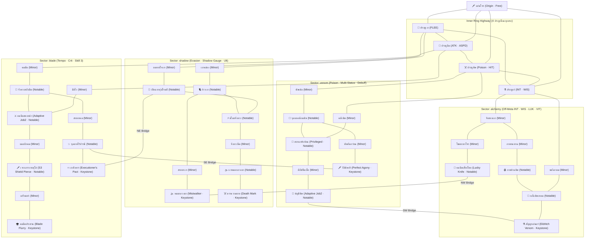

# 🌌 PoE-Style Class-Line Constellation Passive Tree v1

> **Status:** `designed` (Phase 1 Pilot: Thief-Line) · **Stack:** Phaser 3.90.0 + TypeScript strict + Vite single-file (`960×576`)
> **เป้าหมาย:** แทนที่ระบบ Talent แบบ 4 แถวเลือก 1 จาก 3 (`jobTalents` / `job2Talents`) ด้วย **5 Class-Line Constellation Passive Trees** (กราฟโหนดเชื่อมโยง 2 มิติสไตล์ Path of Exile แยก 1 ผังต่ออาชีพหลัก)
> **โค้ดที่เกี่ยวข้อง:**
> - Engine & Data (ใหม่): `src/data/passive-tree.ts`, `src/data/passives/thief.ts`
> - UI & Camera (ใหม่): `src/scenes/character/passive-cam.ts`, `src/scenes/character/passive-tab.ts`
> - Integration (แก้): `src/data/stats.ts`, `src/data/skill-math.ts`, `src/data/tunables.ts`, `src/data/skill-registry.ts`, `src/admin/explain/combo-kit.ts`, `src/data/meta/hero-stats.ts`, `src/save.ts`, `src/scenes/character/talent-tab.ts`, `src/scenes/CharacterScene.ts`, `src/scenes/BattleScene.ts`
> - อ้างอิงระบบเดิม: `src/data/trees/thief.ts`, `src/data/trees2/{rogue,mobster}.ts`, `src/data/trees3/{stalker,kingpin}.ts`, `design/thief-rogue-rework-v1.md`, `docs/design/awakening-last-four-v1.md`

---

## 0. สรุปสั้น (So What)

- **ย้าย Tab 4 (`⭐ ทาเลนต์`) จากรายการ 4 แถวตายตัว → ผังดาวเชื่อมโยง 2 มิติ (Constellation Graph)**: ผู้เล่นวางเส้นทางอิสระจากจุดศูนย์กลาง (`origin`) ผ่าน `minor` → `notable` → `keystone` ที่มีทั้ง **ข้อดี (Upside)** และ **เงื่อนไขแลกเปลี่ยน (Downside)** ชัดเจน
- **คง Skill Web (Tab 3 `✨ สกิล`) ไว้ครบทุกชั้น**: ใยชั้น 1 (`jobTree`), ใยชั้น 2 (`job2Tree`) และใยชั้น 3 Awakening (`job3Tree`) ยังคงเป็นเจ้าของสกิลหลักและการอัปเกรดสกิล · **Passive Tree แทนที่เฉพาะ `jobTalents` + `job2Talents`** และหลอมรวมแต้มจาก Job1 + Job2 + Job3 เข้าผังเดียว
- **แยก 5 ผังตามอาชีพหลัก (`swordsman` / `thief` / `archer` / `mage` / `cleric`) ไม่ใช่ 1 ผังรวม**: ตัดปัญหา dead nodes จากสกิล/ทรัพยากรที่ล็อกตามอาชีพ แต่ยังเปิดให้คลาสย่อยผสมข้ามสายได้อิสระ (เช่น Rogue ↔ Mobster บนผัง Thief-Line)
- **Rollout แบบปลอดภัยไม่พังเซฟเก่า**: Phase 1 เปิดนำร่องเฉพาะ **Thief-Line (~42 โหนด)** · อีก 4 อาชีพหลักยังใช้หน้า `talentTab()` เดิมผ่านเกต `hasPassiveTree(job)` จนกว่าจะถึง Phase 2

---

## 1. ทำไมต้อง "5 Class-Line Trees" แทนที่จะเป็น "1 Global PoE Tree"

### 1.1 ข้อจำกัดของระบบเดิม (`talent-tab.ts`, `tree.ts`)
- ระบบเดิม (`src/data/tree.ts:164-167`, `src/scenes/character/talent-tab.ts:111-186`) บังคับเลือก **1 จาก 3 ต่อแถว** ที่ Job Lv `5 / 10 / 20 / 30` (8 แต้มในขั้น 1 + แยกอีก 10 แต้มในขั้น 2 `job2Talents` ที่แทบทั้งหมดเป็น flat stat ใน `trees2/rogue.ts:29-42` และ `trees2/mobster.ts:26-39`)
- ตัวเลือกในแถวเดียวกันมักถูกจับคู่แบบขวางทางบิลด์ (เช่น โจรอยากเล่นพิษคริ `th_t4b` แต่ต้องทิ้ง `th_t4a` สถานะทับซ้อน และ `th_t4c` หมอกลวงตาแบบไม่มีทางอ้อมเดินไปเอา) และพอเปลี่ยนคลาส 2 (`changeJob2` `src/save.ts:675-692`) ต้องกด `job2Talents` ใหม่แยกอีกหน้า

### 1.2 ทำไมไม่ทำ "1 Global PoE Tree" (ผังเดียวทุกอาชีพ)?
ใน *Novice to Hero* (`src/data/jobs.ts:54-90`, `src/data/jobs2.ts:40-133`) แต่ละอาชีพมี **Class-Locked Skills, Resources และ Mechanics** ต่างกันชัดเจน:

| มิติ | 4-Row Talent เดิม | 1 Global PoE Tree (~200+ โหนด) | 5 Class-Line Constellation Trees (เลือกใช้) |
|---|---|---|---|
| **Dead Nodes** | น้อย แต่ทางเลือกแคบ | **สูงมาก (>70%)** — โจรใช้ Rage / สัตว์ 3 ตัว / Auto Guard / เวทธาตุไม่ได้ | **0%** — ทุกโหนดมี hook ของสายอาชีพนั้น |
| **Cross-Subclass Mixing** | ไม่ได้เลย (แยก `job2Talents`) | ได้ แต่ต้องจ่าย 10–15 travel pts เดินข้ามโซนว่าง | **ได้เต็มที่** (เช่น Rogue ↔ Mobster) ใน 2–4 แต้มผ่าน Ring Highway + Bridges |
| **Trade-off / Build Identity** | ส่วนใหญ่เป็น pure upgrade | สูง แต่เสี่ยง cross-class exploit (เช่น Mage หยิบ Dodge + Auto Guard) | **สูงและคุมสมดุลได้** — 6 Keystones ต่อคลาสมี Upside + Downside ตรงจุด |
| **UX จอ `960×576` & มือถือ** | เรียบง่ายแต่แบน | ลากไกล อ่านลำบากบน viewport `616×394` | **พอดีสายตา** — ~40–46 โหนด/ผัง, ซูมเห็นภาพรวมทั้งผังได้ใน 1 จอ |

### 1.3 กลไก Cross-Subclass Mixing ภายใน Class-Line เดียว
ตัวอย่างบน **Thief-Line** (Thief → Rogue / Mobster → Stalker / Kingpin):
1. **Shared Class-1 Hooks**: ทั้ง Rogue และ Mobster สืบทอด `แทงพิษ` (S1), `เงาพริ้ว` (Ult พื้นฐาน/พายุมีด), `เกจเงา`, `Double Strike` และ `Skill 2` (`ม่านควัน` / `ล้วงกระเป๋า` / `แผลลึก`) ร่วมกัน
2. **Inner Ring Highway + Outer Cross-Build Bridges**: วงแหวนด้านในเชื่อม 4 Sector เข้าหากัน และสะพานวงนอกเชื่อม Sector ข้างเคียง ทำให้ Rogue วิ่งมาหยิบสายพิษ (`Perfect Agony` / `Eldritch Venom`) หรือ Mobster ข้ามไปหยิบสายคริ/เงา (`Blade Flurry` / `Death Mark`) ได้โดยไม่ต้องเสียแต้มย้อนเข้าศูนย์กลาง
3. **Adaptive Job2 Notables**: โหนดที่รับบริบท `PassiveCtx` (`{ job2?: Job2Id; job3?: Job3Id }`) เพื่อปรับข้อความและ stat ให้เข้ากับคลาส 2 ที่ถืออยู่ (และมีค่า default สำหรับ Thief ขั้น 1) → เปลี่ยนคลาส 2 ระหว่าง Rogue ↔ Mobster (`changeJob2`) **ไม่จำเป็นต้องล้างผัง Passive**

---

## 2. ระบบ Node Tiers & Data Contract (~40–46 โหนด/ผัง)

### 2.1 ประเภทโหนด (`PassiveKind`)

| Kind | จำนวน/ผัง | ค่าอัป | บทบาท & กฎการออกแบบ |
|---|---:|---:|---|
| `origin` | 1 | **0 (ฟรี)** | ศูนย์กลางผังที่ `(0, 0)` · เป็นจุดเริ่ม BFS เสมอ (`passiveSpent` ไม่นับแต้ม) |
| `minor` | ~20–22 | 1 แต้ม | Travel Stat Nodes (เช่น +AGI/FLEE, +CRIT, +P.ATK, +Poison Dmg, +INT/M.ATK, +WIS/HP) ให้เส้นทางมีคุณค่าแต่ไม่กลบ Notable |
| `notable` | ~12–15 | 1 แต้ม | Gameplay Mechanics — โหนดกลไกประจำสาย (เช่น ก้าวเงา, ขโมยจังหวะ, สถานะทับซ้อน, เจาะโล่ S3, คมมีดเสี่ยงโชค, Adaptive Job2 Notables) |
| `keystone` | 6 | 1 แต้ม | Build-Defining Nodes อยู่โซนนอก/สะพาน — **บังคับมีทั้ง Upside (สีเขียว) และ Explicit Downside (สีแดง)** ห้ามเป็น pure stat stick |
| `socket` | 0 (Phase 1) → 2–3 (Phase 3) | 1 แต้ม | **Reserved Schema** สำหรับ Phase 3 (ช่องเสียบ Jewel / Monster Card ดัดแปลงโหนดรอบข้างหรือสร้าง synergy พิเศษ) |

### 2.2 Public TypeScript Contract (`src/data/passive-tree.ts`)

```ts
export type PassiveKind = 'origin' | 'minor' | 'notable' | 'keystone' | 'socket'
export type PassiveSector = 'core' | 'blade' | 'shadow' | 'venom' | 'alchemy'
export interface PassiveCtx { job2?: Job2Id; job3?: Job3Id }

export interface PassiveNode {
  id: string                  // Save data: ห้าม rename หลัง ship
  job: JobId
  kind: PassiveKind
  sector: PassiveSector
  x: number; y: number        // World coords รอบ (0, 0): x ∈ [-420, 420], y ∈ [-300, 300], ระยะห่าง ≥ 58px
  edges: readonly string[]    // Undirected neighbors (normalize แบบ symmetric ตอนโหลด)
  icon: string
  name: string
  upside?: string             // Keystone: ข้อความข้อดี (UI สีเขียว UI.green)
  downside?: string           // Keystone: ข้อความข้อเสีย/แลกเปลี่ยน (UI สีแดง UI.red)
  desc: (ctx?: PassiveCtx) => string
  mod: (ctx?: PassiveCtx) => Partial<Stats>
  tags: readonly string[]     // Filter tags: 'blade' | 'poison' | 'shadow' | 'crit' | 'offmeta' | 's3' | 'ult'
}

export interface PassiveTreeDef {
  job: JobId
  title: string
  originId: string
  filters: readonly { tag: string; icon: string; label: string }[]
  nodes: readonly PassiveNode[]
}

export const PASSIVE_RULES = { job1Every: 2, job2Every: 3, job3Every: 5 } as const
```

**Exported Pure Functions (`src/data/passive-tree.ts`):**
- Query: `hasPassiveTree(job)`, `passiveTreeOf(job)`, `passiveNodeById(job, id)`
- Economy: `passiveEarned(jobLevel, job2Level?, job3Level?)`, `passiveSpent(job, picked)`, `passiveFree(job, picked, earned)`
- Graph Mutation & Validation: `normalizePassiveNodes(job, picked)`, `canAllocatePassive(job, picked, nodeId, earned)`, `allocatePassive(job, picked, nodeId, earned)`, `canRefundPassive(job, picked, nodeId)`, `refundPassive(job, picked, nodeId)`
- Stat Aggregation: `passiveMods(job, picked, ctx?)`

**ข้อกำหนดเชิงโครงสร้างของกราฟ (Graph Invariants):**
- **Undirected Symmetry**: หากโหนด `A` ระบุ edge ไป `B` ระบบจะ normalize ให้ `B` เชื่อมกลับ `A` เสมอตอนโหลด
- **No Overlapping Coordinates**: ระยะห่างแบบ Euclidean ระหว่างโหนดคู่ใด ๆ ต้อง **≥ 58px** (ตั้งเป้า **≥ 62px** ใน Pilot เพื่อให้กดง่ายบนจอสัมผัส)
- **Single Connected Component**: ทุกโหนดในผังต้องเดินถึง `originId` ได้ผ่าน BFS (ห้ามมีโหนดหลุดเกาะ)

---

## 3. Thief-Line Pilot Graph (`src/data/passives/thief.ts` — 42 โหนด)

ครอบคลุมสายอาชีพ **🗡️ Thief → 🔪 Rogue / 🕴️ Mobster → 🥷 Stalker / 🎩 Kingpin** รวม **42 โหนด** (`1 origin` + `21 minors` + `14 notables` + `6 keystones`) จัดวางเป็น **4 Sectors รอบแกน `(0, 0)` + 1 Inner Ring Highway + 4 Outer Cross-Build Bridges**

### 3.1 การแบ่ง 4 Sectors & Cross-Build Bridges

| Sector | ทิศบนผัง | ธีมหลัก | จำนวนโหนด (M / N / K) | สะพานเชื่อม (Outer Bridges) |
|---|---|---|---:|---|
| `core` | กลาง `(0, 0)` | 🗡️ แก่นโจร (Origin ฟรี) | 1 Origin | เชื่อมตรงกับ 4 ประตูของ Inner Ring Highway |
| `shadow` | เหนือ (Top) | 👤 Evasion / เกจเงา / Ult | 5M · 4N · 2K | `NW`: เชื่อม `alchemy` (Mistwalker) · `NE`: เชื่อม `blade` (Executioner's Pact) |
| `blade` | ตะวันออก (Right) | 🔪 Tempo / Crit / Skill 3 | 6M · 4N · 2K | `NE`: เชื่อม `shadow` · `SE`: เชื่อม `venom` (Perfect Agony) |
| `venom` | ใต้ (Bottom) | ☠️ Poison / Multi-Status / Debuff | 5M · 3N · 1K | `SE`: เชื่อม `blade` · `SW`: เชื่อม `alchemy` (Eldritch Venom) |
| `alchemy` | ตะวันตก (Left) | ⚗️ Off-Meta INT / WIS / LUK / VIT | 5M · 3N · 1K | `SW`: เชื่อม `venom` · `NW`: เชื่อม `shadow` |

### 3.2 กฎกันซ้ำซ้อนกับ Awakening (🥷 Stalker & 🎩 Kingpin) และ Skill Web

ตรวจสอบจาก `src/data/trees3/stalker.ts`, `src/data/trees3/kingpin.ts`, `src/data/jobs3.ts:97-118`, และ `src/data/skill-math.ts:652-668`:

- **ห้ามซ้ำ 🥷 Stalker (`jobs3.ts:97-107`, `trees3/stalker.ts`)**:
  - Signature `Preserve` (`skill-math.ts:653`) ให้ **Mark Cap +2**, **Mark Duration +1 เทิร์น**, และ **มีดโดนตัวตราเต็ม → Energy +3** แล้ว → **ห้ามสร้างโหนดเพิ่ม Mark Cap หรือ Mark Duration ใน Passive Tree**
  - โหนด `sk_s1` (`trees3/stalker.ts:25`) `Ambush` **ปามีดบินฟรีต้นไฟต์** แล้ว → **ห้ามสร้างโหนดปามีดเปิดเวฟใน Passive Tree**
  - โหนด `sk_p3` (มีดบินข้าม DEF) และ `sk_s4` (`Hide` หลบฉุกเฉินเมื่อ HP < 30%) อยู่ในใยชั้น 3 แล้ว → ไม่ทำซ้ำ
- **ห้ามซ้ำ 🎩 Kingpin (`jobs3.ts:108-118`, `trees3/kingpin.ts`)**:
  - Signature `Loan Shark` (`skill-math.ts:662`) ให้ดาเมจต่อหนี้ + Energy เมื่อ Execute และ `kp_f1` (`trees3/kingpin.ts:25`) แปะพิษ+ช้าต้นไฟต์แล้ว → **ห้ามสร้างโหนดแปะพิษเปิดไฟต์หรือโบนัสดาเมจต่อหนี้แบบเดียวกัน**
- **ห้ามซ้ำ Skill Web ชั้น 1–2 (`trees/thief.ts`, `trees2/rogue.ts`, `trees2/mobster.ts`)**:
  - กลไกหลักของ `thief_a/b/core/u/v` (เช่น `หมายหัว`, `ระเบิดสารพิษ`, `เลือดพิษ`, `เงาสวน`, `เงาพันคม`) และ `rg_k/c/x`, `mb_p/d/e` อยู่ใน Tab 3 อยู่แล้ว · Passive Tree ทำหน้าที่เป็น **Meta-Layer ปรับสไตล์, Trade-off, และเชื่อมบิลด์ข้ามสาย**

### 3.3 รายละเอียด 6 Keystones (Upside + Explicit Downside + R4.6 Bracket Rules)

ทุกตัวเลขต้องอยู่ใน `KIT` (`src/data/skill-math.ts`) ห้าม hardcode ใน `BattleScene.ts` และเคารพกฎ 6 Brackets (**B1–B6**) จาก `design/thief-rogue-rework-v1.md` §R4.6:

| # | Keystone | Sector / Bridge | ▲ Upside (สีเขียว) | ▼ Downside (สีแดง) | Stats / KIT Keys & Bracket |
|---:|---|---|---|---|---|
| 1 | 🗡️ **วิถีพิษคริ (Perfect Agony)** | `venom` (`SE` Bridge) | แปลง `critMul` ส่วนที่เกิน `KIT.thiefAgonyFrom` (140%) เป็นโบนัสดาเมจพิษฐาน (Flat Poison เท่านั้น ไม่รวม `%HP bite` / `hpBleed`, ไม่คูณฮิตที่คริหรือ `ทวงหนี้`) สูงสุด `+100%` รวมกับ `vsPoison` ของ Contaminate | ฮิตกายภาพที่ **ไม่คริ** เบาลง **`-15%`** (`KIT.thiefAgonyHitCut`) | `thPerfectAgony: 0.8` · **B5** Cap `KIT.thiefAgonyCap (1.0)` (`thief-offmeta.ts:34-46`) |
| 2 | 💀 **เงาสังหาร (Executioner's Pact)** | `blade` (`NE` Bridge) | `เงาพริ้ว` / `พายุมีด` + Skill 3: สกิลคริ `+8%` (`thUltExecCrit`), ดาเมจคริ `+15%` (`thUltExecDmg`) ใส่เป้า HP < `50%` หรือติดดีบัฟ ≥ `2` ชนิด + แทงปิดท้าย `0.5x` (`thUltKillFinisher`) ใส่ตัว HP น้อยสุด | หลบแน่นอนของ Ult ลดลง **`-1` ครั้ง** (`ultDodge: -1`, จากฐาน `2` เหลือ `1`) | `thUltExecCrit`, `thUltExecDmg`, `thUltKillFinisher`, `ultDodge: -1` · **B3** Cap `KIT.thiefUltCondCap` / `KIT.thiefCondCritDmgCap` |
| 3 | 🌪️ **คมมีดประสาน (Blade Flurry)** | `blade` (East) | `เงาพริ้ว` / `พายุมีด` แทงเพิ่ม **`+2` ที** (`ultHits: 2`) + On-Hit รวม ~**`50%`** (`thUltOnHitTal` + `KIT.thiefOnHitBase 0.38`, Cap `0.55`) · **Mobster Adaptive**: `ทวงหนี้` ฟันซ้ำเพิ่ม 1 รอบที่ **`0.5x`** (`thMobFlurry`) | ดาเมจฐานต่อทีแทงของ Ult ลดลง **`-10%`** (`thFlurryDmgCut`) เพื่อคุม `thiefUltBudget()` ให้อยู่ในเพดาน (Q2) | `ultHits: 2`, `thUltOnHitTal`, **NEW** `thFlurryDmgCut`, `thMobFlurry` · `KIT.thiefFlurryDmgCut (0.1)`, `KIT.thiefMobFlurryMul (0.5)` |
| 4 | 🌫️ **หมอกลวงตา (Mistwalker / Acrobatics)** | `shadow` (`NW` Bridge) | ลดดาเมจ **`+25%`** (`thMistDr`) ต่อการโจมตีเวท / `monHit >= 999` / `trueSight` · มอนตีโดนขั้นต่ำลดลง **`-8%`** (`fleeFloor: 0.08`, Cap รวม `0.20` → ต่ำสุด 60%) · เริ่มทุกเวฟหลบแน่นอน **`+1` ครั้ง** (`waveDodge: 1`) | **P.DEF ลดลง `-30%`** (ใน `heroBuild`) และ **โล่ทุกชนิดที่ได้รับลดลง `-30%`** (ใน `addShield`) | `fleeFloor`, `waveDodge`, **NEW** `thMistDr`, `thDefShieldCut` · `KIT.thiefMistDr (0.25)`, `KIT.thiefMistDefCut (0.3)` |
| 5 | ☠️ **ตราความตาย (Death Mark)** | `shadow` (North) | กด Ult (`เงาพริ้ว` / `พายุมีด` / `ทวงหนี้`) แปะ **Death Mark** ใส่มอนที่ HP สูงสุดนาน **`2` เทิร์นฮีโร่** · บันทึก `netHpDmg` ของทุกฮิตฮีโร่ที่ไม่ใช่ DoT (`!dot`) · ระเบิดเมื่อหมดเวลา / HP < **`15%`** / ก่อน `killMon` เป็น **`35%` Pure Echo** | **Ult Cooldown เพิ่ม `+1` เทิร์น** (`thUltCdAdd: 1` ใน `ultCooldown()`) | **NEW** `thDeathMark`, `thUltCdAdd` · **B6 Pure Echo** (`dot=true, echo=true`, ข้าม `srcMul` & B1–B5, ไม่ดูดเลือด, ไม่บันทึกซ้ำ) · `KIT.thiefDeathMarkTurns (2)`, `KIT.thiefDeathMarkAt (0.15)`, `KIT.thiefDeathMarkEcho (0.35)` |
| 6 | ⚗️ **สัญญาเล่นแร่ (Eldritch Venom)** | `alchemy` (`SW` Bridge) | ผสาน **INT / M.ATK** เข้าพิษและสกิล (เสริม `poisonDmg` จาก `M.ATK × KIT.poison.matkPer × KIT.thiefEldritchMatkShare` ใน `heroBuild`) + **Toxic Overheal**: ฮีลจากพิษ (`toxicHealing`) ส่วนที่ล้น Max HP แปลงเป็นโล่สูงสุด **`20%` Max HP** | **ดูดเลือดกายภาพปกติ (`lifesteal`) ลดลง `-50%`** (`thPhysLeechCut` ใน `strike()`) | **NEW** `thEldritchVenom`, `thPhysLeechCut` · `KIT.thiefOverhealCap (0.2)`, `KIT.thiefEldritchMatkShare (0.5)`, `KIT.thiefPhysLeechCut (0.5)` |

> **ข้อสังเกตเชิงสมดุล (Anti-All-In Keystone Trade-off):** Downside ของ Keystones ออกแบบให้เกิดแรงเสียดทานกันเองโดยธรรมชาติ เช่น `Mistwalker` (`-30%` โล่) ขัดกับโล่จาก `Eldritch Venom`, `Death Mark` (`+1` Ult CD) ชะลอจังหวะปั่น Ult ของ `Blade Flurry`, และ `Executioner's Pact` (`-1` Ult dodge) ทำให้สายหลบต้องเลือกระหว่างเอาตัวรอดกับปิดงาน — ทำให้ผู้เล่นที่มี 36–42 แต้มตอน Endgame ยังต้อง "เลือก" ไม่ใช่ "เหมาทุก Keystone"

### 3.4 ผังโหนดครบ 42 โหนด (Reference Blueprint)

> หมายเหตุ: IDs ที่ ship ใน `src/data/passives/thief.ts` เป็น Save Data ถาวร (ห้าม rename หลังปล่อย) · ตารางด้านล่างระบุบทบาท, stat mapping และความสืบเนื่องจาก talent เดิม (`th_t*`, `rg_t*`, `mb_t*`)

#### Core & Inner Ring Highway (5 โหนด: 1 Origin + 4 Minors)
- `th_origin` (`origin`, `core`, `(0, 0)`): 🗡️ **แก่นโจร** — จุดเริ่มผัง (ฟรี)
- `th_r_shadow` (`minor`, `shadow`): ประตูวงแหวนเหนือ — `+FLEE` · เชื่อม `th_origin`, `th_r_blade`, `th_r_alchemy`
- `th_r_blade` (`minor`, `blade`): ประตูวงแหวนตะวันออก — `+P.ATK / +ASPD` · เชื่อม `th_origin`, `th_r_shadow`, `th_r_venom`
- `th_r_venom` (`minor`, `venom`): ประตูวงแหวนใต้ — `+Poison Dmg / +HIT` · เชื่อม `th_origin`, `th_r_blade`, `th_r_alchemy`
- `th_r_alchemy` (`minor`, `alchemy`): ประตูวงแหวนตะวันตก — `+INT / +WIS` · เชื่อม `th_origin`, `th_r_shadow`, `th_r_venom`

#### Sector 1: `shadow` — Evasion / Shadow Gauge / Ult (อีก 10 โหนด: 4 Minors + 4 Notables + 2 Keystones)
- **Minors (4)**: `เงาคล่อง (+FLEE)`, `ลมหายใจเงา (+Energy/ASPD)`, `สายตาเงา (+HIT/+FLEE)`, `จังหวะมืด (+FLEE/+Crit)`
- **Notables (4)** (สืบทอดจาก `trees/thief.ts:59-69`):
  1. 🐈 **ก้าวเงา** (`thWaveGauge: 2`, `thDodgeFlee: 20` — จาก `th_t1a`)
  2. 💨 **เปิดฉากซุ่มโจมตี** (`waveDodge: 2`, `thWaveOpenCrit: 1`, `thWaveOpenCritDmg: KIT.thiefOpenCritDmg` — จาก `th_t1b`)
  3. ⚡ **ขโมยจังหวะ** (`dodgeEnergy: 25`, `thDodgeCdCut: 1`, `thDodgeCdIcd: 2` — จาก `th_t2a`)
  4. 🌫️ **เงาหมอกลวงตา** (`ultDodge: 2`, `ultPoison: 3`, `thUltGauge: 1` — จาก `th_t3c`)
- **Keystones (2)**: 🌫️ **หมอกลวงตา (Mistwalker)** (`NW` Bridge), ☠️ **ตราความตาย (Death Mark)** (North Outer)

#### Sector 2: `blade` — Tempo / Crit / Skill 3 (อีก 11 โหนด: 5 Minors + 4 Notables + 2 Keystones)
- **Minors (5)**: `คมมีด (+P.ATK)`, `มือไว (+Combo)`, `สายตาคม (+Crit)`, `แผลลึกคม (+CritMul)`, `เตรียมท่า (+SkillCrit / +HIT)`
- **Notables (4)**:
  1. 🧪 **จังหวะสลับมีด** (`thWeaveDmg: 0.4`, `thWeaveRes: 16` — จาก `th_t2c`)
  2. 🗡️ **เจาะเกราะทะลุโล่** (**NEW**: `thS3ShieldPierce: 1`, `s3Pow: 0.15` — Skill 3 `Back Stab` / `ตัดเส้นเอ็น` ทะลุ `m.shield` 100%)
  3. ⚔️ **คมมีดสองหน้า (Adaptive Job2 #1)**:
     - `rogue`: `j2KnifeMul +0.18`, `combo +0.04` (แทนเอกลักษณ์ `rg_t1_combo` / `rg_t2_knife`)
     - `mobster`: `s3Pow +0.20`, `j2DebuffTurns +1` (แทนเอกลักษณ์ `mb_t3_cut` / `mb_t3_turns`)
     - base `thief`: `combo +0.04`, `atk +8`
  4. 💥 **จุดตายไร้ปรานี** (`crit +0.06`, `critMul +0.18`, `skillCrit +0.04` — รวมสายคริจาก `rg_t1_crit`/`rg_t3_gore`/`mb_t4_gore`)
- **Keystones (2)**: 💀 **เงาสังหาร (Executioner's Pact)** (`NE` Bridge), 🌪️ **คมมีดประสาน (Blade Flurry)** (East Outer)

#### Sector 3: `venom` — Poison / Multi-Status / Debuff (อีก 8 โหนด: 4 Minors + 3 Notables + 1 Keystone)
- **Minors (4)**: `พิษเข้ม (+Poison Dmg)`, `คลังพิษ (+Poison Cap)`, `พิษกัดกร่อน (+vsPoison)`, `ดีบัฟยืดเยื้อ (+SkillCrit / +Poison Dmg)`
- **Notables (3)**:
  1. 🎯 **จุดบอดซ้อนพิษ** (`thStackCritTal: 0.016` — จาก `th_t2b`, เชื่อมสะพาน `SE` ไปหา `blade`)
  2. 🧫 **สถานะทับซ้อน** (`thPrivileged: 0.30` — จาก `th_t4a` เข้า B1 Taken)
  3. 📒 **บัญชีพิษ (Adaptive Job2 #2)**:
     - `mobster`: `j2ExecAdd +0.02`, `vsPoison +0.08`, `poisonCap +4` (แทนเอกลักษณ์ `mb_t2_exec` / `mb_t4_cap`)
     - `rogue`: `j2KnifeStatus +0.25`, `vsPoison +0.08`, `killHeal +0.03` (แทนเอกลักษณ์ `rg_t4_kill` + เสริมสถานะมีดบิน)
     - base `thief`: `poisonDmg +2`, `poisonCap +4`, `vsPoison +0.08`
- **Keystone (1)**: 🗡️ **วิถีพิษคริ (Perfect Agony)** (`SE` Bridge)

#### Sector 4: `alchemy` — Off-Meta INT / WIS / LUK / VIT (อีก 8 โหนด: 4 Minors + 3 Notables + 1 Keystone)
- **Minors (4)**: `พลังอาคม (+M.ATK / +SpellCrit)`, `จิตสงบเงา (+M.DEF / +Tenacity)`, `โชคชะตาโจร (+Lucky Dodge / +Crit)`, `กายทนทาน (+Max HP / +Regen)`
- **Notables (3)**:
  1. 🩸 **กายต้านพิษ** (`thCondTenacity: 0.14`, `thStackHp: 14` — จาก `th_t1c`, สาย VIT/Survival)
  2. 🎲 **คมมีดเสี่ยงโชค** (**NEW**: `thLuckyKnife: 1`, `luckyDodge +0.04` — เมื่อ LUK `LUCKY!` ทำงานใน `gamblerLucky()`: Rogue ปามีดฟรี 1 เล่ม / Mobster แปะพิษ `+2` stack (`KIT.thiefLuckyPoison`))
  3. 🔮 **กลั่นพิษอาคม** (`matk +16`, `poisonDmg +2`, `skillCrit +0.05` — สะพานสู่สาย INT `thief_v` เล่นแร่พิษ)
- **Keystone (1)**: ⚗️ **สัญญาเล่นแร่ (Eldritch Venom)** (`SW` Bridge)

### 3.5 แผนผังกราฟ Constellation (Mermaid `graph TD`)



---

## 4. Point Economy & กฎการอัป / คืนแต้ม (Derived, Never Stored)

### 4.1 สูตรคำนวณแต้ม (`PASSIVE_RULES`)
แต้ม Passive **ไม่ถูกเก็บเป็นตัวเลขใน `SaveData`** แต่คำนวณสดทุกครั้ง (เหมือน `talentEarned` ใน `src/data/tree.ts:798-799`) เพื่อป้องกันปัญหาแต้มหาย/แต้มซ้ำเมื่อ migrate หรือเปลี่ยนอาชีพ:

```ts
export const PASSIVE_RULES = { job1Every: 2, job2Every: 3, job3Every: 5 } as const

passiveEarned(jobLevel, job2Level, job3Level) =
  Math.floor(Math.max(0, jobLevel)  / 2) +   // Job1 (นับเมื่อ job !== 'novice')
  Math.floor(Math.max(0, job2Level) / 3) +   // Job2 (นับเฉพาะเมื่อมี job2)
  Math.floor(Math.max(0, job3Level) / 5)     // Job3 (นับเฉพาะเมื่อ activeJob3(s) เปิดอยู่)
```

| ช่วงความก้าวหน้า | เลเวล | แต้มจากชั้นนี้ | แต้มสะสมรวม | เป้าหมายบิลด์ที่ควรถึง |
|---|---|---:|---:|---|
| กลางคลาส 1 | Job1 Lv 14 | +7 | **7** | เดินจาก Origin → 1 Notable + แตะ Keystone แรก |
| จบคลาส 1 (`JOB_CHANGE.classMaxJobLevel` `jobs.ts:18`) | Job1 Lv 40 | +20 (max) | **20** | 1 Sector หลัก + 1–2 Keystones + แวะ Ring Highway |
| กลางคลาส 2 | Job1 40 · Job2 Lv 25 | +8 | **28** | ข้าม Outer Bridge ผสม 2 Sectors (เช่น Rogue + Venom) |
| จบคลาส 2 (`JOB2_RULES.maxJobLevel` `jobs2.ts:25`) | Job1 40 · Job2 Lv 50 | +16 (max) | **36** | 2–3 Keystones + Adaptive Job2 Notables ครบคู่ |
| จบ Awakening ปัจจุบัน (`JOB3_RULES.maxJobLevel` `jobs3.ts:23`) | + Job3 Lv 30 | +6 | **42** | ปั้นบิลด์เต็มรูปแบบ (เลือกเส้นทางข้ามสายได้อิสระโดยไม่เหมาทุก Keystone) |
| เพดานขยายอนาคต (หากเพิ่ม Job3 Cap → Lv 50) | + Job3 Lv 50 | +10 (max) | **46** | รองรับโหนด `socket` (2–3 ช่อง) ใน Phase 3 โดยไม่ต้องแก้สูตร |

> **หมายเหตุ SA (`src/data/jobs3.ts:23`):** ปัจจุบัน `JOB3_RULES.maxJobLevel = 30` (ให้ +6 แต้ม → รวม 42 แต้ม) แต่สูตร `Job3 Lv / 5` รองรับเพดาน `Job3 Lv 50` (+10 → รวมสูงสุด 46 แต้ม) ทันทีเมื่อเกมขยายเพดาน Awakening หรือเปิด Jewel Sockets ใน Phase 3

### 4.2 กฎ BFS Allocation & BFS Connectivity-Preserving Refund
1. **Allocate (`canAllocatePassive` / `allocatePassive`)**:
   - `originId` เปิดใช้งานฟรีเสมอ (ไม่ต้องกดอัป และไม่หักใน `passiveSpent`)
   - กดอัปโหนด `v` ได้เมื่อ: `v !== originId`, ยังไม่อัป `v`, `passiveFree >= 1`, และมีเพื่อนบ้าน `u ∈ v.edges` อย่างน้อย 1 โหนดที่เป็น `originId` หรืออยู่ใน `picked`
2. **Single-Node Refund (`canRefundPassive` / `refundPassive`) — ฟรีในเมือง**:
   - กดคืนโหนด `v` ได้เมื่อ: `v ∈ picked`, `v !== originId`, และเมื่อจำลองลบ `v` ออก (`remaining = picked \ {v}`) แล้วทำ **BFS จาก `originId`** ผ่านเฉพาะโหนดใน `remaining` ต้องเดินถึงครบทุกโหนดใน `remaining` (`visited.size === remaining.size`)
   - **Articulation Point Guard**: หากลบ `v` แล้วมีโหนดปลายทางขาดจาก `originId` จะไม่อนุญาตให้ลบ (UI แสดงข้อความ `"คืนไม่ได้: มีโหนดอื่นเชื่อมผ่านอยู่"`) · แต่ถ้าผู้เล่นเชื่อม Ring Highway หรือ Outer Bridge เป็นวงปิดแล้ว สามารถถอดโหนดเก่ากลางทางออกได้เหมือน PoE!
3. **Full Free Reset**:
   - ปุ่ม `"รีเซ็ตฟรี"` ตั้ง `s.passiveNodes = []` + `persist()` + `redraw()` คืนแต้มทั้งหมดทันทีในเมือง
4. **กรณีเปลี่ยนอาชีพ (`src/save.ts`)**:
   - `changeJob()` (`save.ts:645-654`) / `repickJob()` (`save.ts:825-846`): ล้าง `s.passiveNodes = []` เพราะสลับ Class-Line ใหม่
   - `changeJob2()` (`save.ts:675-692`): **คง `s.passiveNodes` ไว้** เพราะอยู่ใน Class-Line เดียวกัน (Adaptive Job2 Notables ปรับผลให้อัตโนมัติ) · กรณีที่การเปลี่ยน `job2` ทำให้ `job3` ถูก park จนแต้ม `earned` ลดลงต่ำกว่า `passiveSpent` ระบบจะเตือนและ/หรือ trim โหนดปลายใบ (leaf nodes) ตามลำดับย้อนหลังให้ `spent <= earned` อย่างปลอดภัยโดยรักษา connectivity

---

## 5. UI & UX Spec (`CharacterScene` Tab 4)

อ้างอิงโครงสร้างจริงของ `src/scenes/CharacterScene.ts` (`W = 960, H = 576` ใน `src/data/ui-tokens.ts:4-5`, Sidebar ซ้าย `x: 16..314, y: 70..560` ใน `src/scenes/character/preview.ts:31`, แถบ Tab `x: 330, y: 84` ใน `CharacterScene.ts:127-139`):

### 5.1 การสลับหน้า Tab 4 (`src/scenes/character/talent-tab.ts`)
- `s.job === 'novice'` → แสดงหน้าล็อกอธิบายการปลดล็อกหลังเปลี่ยนอาชีพเหมือนเดิม (`talent-tab.ts:26-49`)
- `hasPassiveTree(s.job) === true` (Phase 1: `'thief'`) → เรียก `passiveTab(scene)` ใน `src/scenes/character/passive-tab.ts`
- `hasPassiveTree(s.job) === false` (Phase 1: Swordsman / Archer / Mage / Cleric) → ใช้หน้า 4-row `talentTab` เดิม 100%

### 5.2 โครงสร้าง Embedded View (`616 × 394` Viewport)

```text
+---------------------------+---------------------------------------------------+
| Left Sidebar (298×490)    | Tab Strip: [อุปกรณ์][การ์ด][สถานะ][สกิล][⭐ ทาเลนต์]  |
| x: 16..314, y: 70..560    +---------------------------------------------------+
|                           | Control Bar (y: 108..142)                         |
| [Hero Compact Strip]      | ⭐ เหลือ X/Y  [🔪มีด][☠️พิษ][👤เงา][💥คริ][⚗️นอกกระแส] |
| ------------------------- |              [🎯 กลาง] [⛶ เต็มจอ] [รีเซ็ตฟรี]        |
| [Inspect-then-Allocate]   +---------------------------------------------------+
|  Icon + Name + Kind Badge |                                                   |
|  Sector · Tags            |       Constellation 2D Pan & Zoom Viewport        |
|  Description (Adaptive)   |             616 × 394 px                          |
|                           |        (x: 326..942, y: 146..540)                 |
|  [Keystone Only:]         |     • Geometry Mask clip + Starfield BG           |
|  ▲ Upside (UI.green)      |     • Drag ≥ 8px = Pan · Wheel / ± = Zoom         |
|  ▼ Downside (UI.red)      |     • Tap Node = Inspect (Select)                 |
|                           |     • Bottom-Right Mini Controls: [−] [100%] [+]  |
|  [✨ อัปโหนด (1 แต้ม)]     |                                                   |
|  หรือ [↩️ คืนแต้ม (+1)]    |                                                   |
+---------------------------+---------------------------------------------------+
```

- **Top Control Bar (`y: 108..142`)**:
  - **Points Counter**: `⭐ แต้มเหลือ: {free}` (สี `UI.gold` เมื่อ `> 0`, `UI.sub` เมื่อ `0`) + tooltip/sub-text `ได้ {earned} (J1+J2+J3)`
  - **Tag Filter Pills (5 ปุ่ม)**: `🔪 มีด` (`blade`), `☠️ พิษ` (`poison`), `👤 เงา` (`shadow`), `💥 คริ` (`crit`), `⚗️ นอกกระแส` (`offmeta`) — แตะเพื่อ toggle (เลือกได้ทีละ 1 tag หรือล้างออกเมื่อแตะซ้ำ) · โหนดที่ match เรืองขอบสีทอง โหนดที่ไม่ match ลด alpha เหลือ `~0.28`
  - **Action Buttons**: `🎯` (Center กล้องกลับ `(0, 0)` + zoom default), `⛶` (เปิด Fullscreen Modal `960×540`), `รีเซ็ตฟรี` (enabled เมื่อ `passiveSpent > 0`)

### 5.3 2D Pan & Zoom Camera (`src/scenes/character/passive-cam.ts`)
แยกคณิตศาสตร์กล้องออกจาก Phaser Scene เพื่อให้ unit-test ได้ 100% (`tests/passive-cam.test.ts`):
- `PassiveCamState`: `{ panX: number; panY: number; zoom: number; minZoom: number; maxZoom: number }` (ค่าเริ่มแนะนำ: `minZoom: 0.55`, `maxZoom: 1.65`, default `zoom: 0.78` ใน embedded และ `1.0` ใน fullscreen)
- `worldToScreen(cam, view, wx, wy)` / `screenToWorld(cam, view, sx, sy)` / `containerTransform(cam, view)`: แปลงพิกัดโลก ↔ พิกัดหน้าจอแบบ round-trip แม่นยำและคำนวณ transform ของ Phaser Container
- `clampCam(cam, bounds, view)` / `panBy(cam, bounds, view, dx, dy)` / `fitCamToBounds(cam, bounds, view)`: จำกัด `panX`/`panY` จาก `computeGraphBounds(nodes)` + margin กันลากหลุดขอบ และปรับกล้องให้พอดีทั้งผัง
- `zoomAt(cam, view, nextZoom, anchorSx, anchorSy)` / `zoomByWheel` / `zoomStep`: รักษาจุดโลกใต้เคอร์เซอร์/จุดกึ่งกลางให้คงที่ตอนซูม
- `pickNodeAt(nodes, cam, view, sx, sy, radiusByKind)`: Hit-test โดยขยาย touch target อัตโนมัติเมื่อซูมออก (`Math.max(r * zoom, 18)`) เพื่อรองรับนิ้วบนมือถือ
- **Drag vs Tap Threshold**: ใช้รูปแบบ scene-level pointer listeners เหมือน `src/scenes/character/web-scroll.ts:66-121` (ขยับ ≥ `8px` = Pan, ยกนิ้วโดยขยับ < `8px` = Tap เลือกโหนด) และตัด listener สะอาดใน `shutdown` event

### 5.4 Inspect-then-Allocate & Visual Hierarchy
- **แตะครั้งที่ 1 = Inspect เท่านั้น (ไม่หักแต้มทันที)**: ป้องกันนิ้วลั่นบนมือถือ โดยเฉพาะ Keystone ที่มี Downside สีแดง
- **Detail Panel (Left Sidebar เมื่อ `tab === 4 && hasPassiveTree(job)`)**:
  - แสดง Compact Hero Strip ด้านบน (pattern เดียวกับ `drawSkillHeroStrip` ใน `src/scenes/character/preview.ts:99-102, 173-211`)
  - ชื่อโหนด, Icon, Badge (`Origin` / `Minor` / `Notable` / `Keystone`), Sector, Tags
  - ข้อความผลลัพธ์ (`node.desc({ job2, job3 })`)
  - สำหรับ **Keystone**: แยกบล็อก **▲ ข้อดี** (`UI.green` `#6fd08c`) และ **▼ ข้อเสีย / เงื่อนไข** (`UI.red` `#ff7a7a`) ชัดเจน
  - ปุ่มยืนยันด้านล่าง:
    - อัปได้ → ปุ่มทอง `✨ อัปโหนด (1 แต้ม)` (อัปแล้วอัปเดต `s.passiveNodes`, `persist()`, เล่นเสียง `sfx.pop()`, วาดซ้ำโดย **ไม่รีเซ็ตตำแหน่ง pan/zoom กล้อง**)
    - อัปแล้ว & คืนได้ → ปุ่ม `↩️ คืนแต้ม (+1)`
    - อัปแล้วแต่เป็นสะพาน → แสดงข้อความ `"🔒 คืนไม่ได้: มีโหนดอื่นเชื่อมผ่านอยู่"`
    - ยังเชื่อมไม่ถึง → แสดงข้อความ `"🔒 ต้องอัปโหนดข้างเคียงก่อน"` หรือ `"แต้มไม่พอ"`
- **สีและรูปทรงโหนด**:
  - `origin`: วงกลมใหญ่ขอบทอง · `minor`: วงกลมเล็ก · `notable`: วงกลมกลางขอบสองชั้น · `keystone`: รูปเพชร/แปดเหลี่ยมใหญ่ + ออร่าสีประจำ Sector
  - เส้นเชื่อม (Edges): ทองสว่างเมื่อทั้งสองฝั่งอัปแล้ว · เขียวจางเมื่อฝั่งหนึ่งอัปแล้วอีกฝั่งอัปได้ · เทาเข้ม (`UI.line`) เมื่อยังไม่เปิด

### 5.5 Fullscreen Modal Toggle (`960 × 540`)
- เมื่อกดปุ่ม `⛶` เปิด container overlay ระดับ modal (`depth` สูงสุดใต้ toast, ขนาดกรอบ **`960 × 540`**, คลุมพื้นที่หลักใน canvas `960×576`)
- ปิดได้ทั้งปุ่ม `✕ ปิด` มุมขวาบน และปุ่มคีย์บอร์ด **`ESC`** (`src/scenes/CharacterScene.ts:93-100`)
- แชร์ `PassiveCamState` (หรือปรับ zoom ให้เห็นทั้ง 42 โหนดเต็มตา) พร้อมแถบ Tag Filter Pills ด้านบน, ปุ่ม `− / 🎯 / +` มุมขวาล่าง, และ Floating Inspector Card มุมซ้ายเมื่อแตะโหนด (ไม่บังพื้นที่กลางผัง)

---

## 6. Save Schema, Migration, Battle Hooks & Test Plan

### 6.1 Save Schema & Corrupt-Data Guards (`src/save.ts`, `src/data/meta/hero-stats.ts`)
- เพิ่มฟิลด์ใน `SaveData` (`src/save.ts:44-125`) และ `StatsInput` (`src/data/meta/hero-stats.ts:21-52`):
  ```ts
  passiveNodes?: string[] // Allocated PoE Passive Tree node IDs (originId is implicit/free; points are derived)
  ```
- **Guard ใน `load()` / `normalizeEndgameFields()` (`src/save.ts:196-235, 977-1060`)**:
  - หาก `s.passiveNodes` ไม่ใช่ array → ลบหรือตั้งเป็น `[]`
  - กรองเฉพาะ `typeof x === 'string'` ที่ไม่ซ้ำ
  - รัน `normalizePassiveNodes(s.job, s.passiveNodes)` เพื่อรับประกันว่าทุก ID เป็นโหนดจริงของอาชีพนั้นและยังเชื่อมติด `originId` ผ่าน BFS
  - กันกรณี `spent > earned` (เช่น หลัง `changeJob2` ที่ทำให้ `job3` ถูก park) โดยตัด leaf nodes เกินออกทีละตัวจน `spent <= earned`

### 6.2 Migration & Backward-Safe Fallback
- **Non-migrated Classes (`swordsman` / `archer` / `mage` / `cleric` ใน Phase 1)**:
  - `hasPassiveTree(job)` คืน `false` → `heroBuild()` (`hero-stats.ts:352, 376`) อ่าน `talentMods` + `talent2Mods` และ `talentTab()` แสดงหน้า 4 แถวตามเดิม 100%
- **Thief-Line Migration (เมื่อโหลดเซฟเก่าของ `s.job === 'thief'`)**:
  - Bump version flag (เช่น `THIEF_REWORK_VER` ใน `src/save.ts:503` หรือ flag เฉพาะ `passiveTreeMigrated`) แบบ idempotent:
    - ล้าง `s.jobTalents = {}` และ `s.job2Talents = {}`
    - ตั้ง `s.passiveNodes = []` (ไม่ต้องคืนแต้มลง `skillPoints` เพราะแต้ม Passive คำนวณสดจาก `jobLevel` / `job2Level` / `job3Level`)
  - ใน `newSave()` (`src/save.ts:135-185`): ตั้ง flag เป็นเวอร์ชันล่าสุดทันที
- **Unit-Test Isolation Rule ใน `heroBuild()` (`src/data/meta/hero-stats.ts`)**:
  - เมื่อ `hasPassiveTree(job.id)` เป็น `true`:
    - หาก `s.passiveNodes !== undefined` (รวมถึง `[]` ในเซฟเกมจริงทั้งหมดหลัง migration): ใช้ `passiveMods(job.id, s.passiveNodes, { job2: j2?.id, job3: j3 })` **แทนที่** `talentMods` + `talent2Mods`
    - หาก `s.passiveNodes === undefined` และมี `s.jobTalents` หรือ `s.job2Talents` ส่งเข้ามาโดยตรง (เฉพาะ synthetic `StatsInput` ใน unit test เก่า): fallback อ่าน `talentMods` / `talent2Mods` เพื่อรักษาความเข้ากันได้ของ test เก่าโดยไม่กระทบเกมจริง

### 6.3 New `Stats` Keys, `KIT` Keys & BattleScene Integration Summary

#### New `Stats` Keys (`src/data/stats.ts` — init `0` ใน `PLAYER`)
| Key | แหล่ง | การใช้งาน |
|---|---|---|
| `thDeathMark` | Keystone `ตราความตาย` | Echo ratio (`0.35`) ของ Death Mark pop (B6) |
| `thUltCdAdd` | Keystone `ตราความตาย` (Downside) | เพิ่ม CD Ult (`+1`) ใน `ultCooldown()` (`src/data/skill-math.ts:571-574`) |
| `thMistDr` | Keystone `หมอกลวงตา` | DR (`0.25`) ต่อเวท / `monHit >= 999` / `trueSight` ใน `BattleScene.hurtHeroCore()` |
| `thDefShieldCut` | Keystone `หมอกลวงตา` (Downside) | ตัด `st.def` `-30%` ใน `heroBuild()` + ตัดโล่ที่ได้รับ `-30%` ใน `BattleScene.addShield()` |
| `thFlurryDmgCut` | Keystone `คมมีดประสาน` (Downside) | ตัดดาเมจฐานต่อทีแทงของ Ult `-10%` ใน `BattleScene` + `thiefUltBudget()` (`skill-math.ts:555`) |
| `thMobFlurry` | Keystone `คมมีดประสาน` (Mobster) | `ทวงหนี้` ฟันซ้ำเพิ่ม 1 รอบที่ `KIT.thiefMobFlurryMul` (`0.5x`) |
| `thEldritchVenom` | Keystone `สัญญาเล่นแร่` | เสริมพิษจาก M.ATK ใน `heroBuild()` + เปิด Toxic Overheal Shield ใน `BattleScene.heal()` |
| `thPhysLeechCut` | Keystone `สัญญาเล่นแร่` (Downside) | ตัด `lifesteal` กายภาพปกติ `-50%` ใน `BattleScene.strike()` |
| `thS3ShieldPierce` | Notable `เจาะเกราะทะลุโล่` | Skill 3 (`Back Stab` / `ตัดเส้นเอ็น`) ข้าม `m.shield` ใน `BattleScene.damageMon()` |
| `thLuckyKnife` | Notable `คมมีดเสี่ยงโชค` | `gamblerLucky()`: Rogue ปามีดฟรี 1 เล่ม · Mobster แปะพิษ `+KIT.thiefLuckyPoison` (`2`) |

#### New `KIT` Keys (`src/data/skill-math.ts` + ลงทะเบียนครบ `tunables.ts` / `skill-registry.ts` / `combo-kit.ts`)
- **INTS (`KIT_INTS`)**: `thiefDeathMarkTurns: 2`, `thiefLuckyPoison: 2`
- **NUMS (`KIT_NUMS`)**: `thiefDeathMarkAt: 0.15`, `thiefDeathMarkEcho: 0.35`, `thiefMistDr: 0.25`, `thiefMistDefCut: 0.3`, `thiefFlurryDmgCut: 0.1`, `thiefMobFlurryMul: 0.5`, `thiefOverhealCap: 0.2`, `thiefEldritchMatkShare: 0.5`, `thiefPhysLeechCut: 0.5`

> ทุก key ต้องผ่าน checklist §R4.7.1 ใน `design/thief-rogue-rework-v1.md` เพื่อให้ `admin-engine.test.ts` และ `skill-registry.test.ts` ผ่าน 100%

### 6.4 Rollout Roadmap (3 Phases)

| Phase | ขอบเขตงาน | เงื่อนไขเสร็จสิ้น |
|---|---|---|
| **Phase 1: Thief-Line Pilot** | `passive-tree.ts` engine · `passives/thief.ts` (~42 โหนด) · `passive-cam.ts` + `passive-tab.ts` + Fullscreen Modal · Save migration + BattleScene hooks · อีก 4 คลาส fallback ใช้ `talentTab` เดิม | `npm run typecheck` = 0 errors · unit tests ผ่านครบ · smoke playtest Rogue/Mobster/Stalker/Kingpin ผ่าน |
| **Phase 2: 4 อาชีพหลักที่เหลือ** | สร้างผัง Constellation ทีละคลาส: `passives/swordsman.ts` (Berserker/Knight/Warlord/LK) → `archer.ts` (BM/Innovator/Ranger/Mechanic) → `mage.ts` (Wizard/Sage/HW/Professor) → `cleric.ts` (Crusader/Monk/Paladin/Champion) | `hasPassiveTree(job)` = `true` ครบ 5 อาชีพหลัก · ไม่มีโหนดซ้ำกับ Awakening ของแต่ละสาย |
| **Phase 3: Legacy Cleanup & Jewel Sockets** | ถอด legacy 4-row UI (`jobTalents` / `job2Talents`) ออกจาก `talent-tab.ts` และ `trees*/*.ts` (คง migration ล้าง key เก่าใน `save.ts`) · เปิดโหนด `kind: 'socket'` (2–3 ช่อง/ผัง) สำหรับเสียบ Jewel / Monster Card | ลบ dead code ครบ · เพิ่มระบบ Socket UI + Save `passiveSockets?: Record<string, string>` |

### 6.5 Test Plan

#### 1. New Unit Tests (Phaser-free, รันเร็วด้วย `node tools/test.mjs <name>`)
- **`tests/passive-tree.test.ts`**:
  - Graph Integrity: edges สมมาตร (undirected), ทุกโหนดเดินถึง `originId` ได้ผ่าน BFS, ไม่มี duplicate ID, ระยะห่างระหว่างโหนดทุกคู่ ≥ 58px, ไม่มีโหนดซ้ำ `Preserve` / `Ambush`
  - Point Economy: `passiveEarned` ที่ Job1 Lv 0/1/2/40, Job2 Lv 0/3/50, Job3 Lv 0/5/30/50 · `originId` ไม่หักแต้ม
  - BFS Allocation & Refund: อัปโหนดติดขอบได้, อัปโหนดไกลไม่ได้, อัปเมื่อแต้ม 0 ไม่ได้ · คืนใบ (leaf) ได้, คืนจุดสะพาน (articulation point) ไม่ได้, **คืนได้หลังเชื่อมวงแหวน (loop) ครบ**
  - Normalization & Migration: `normalizePassiveNodes` ตัด ID ขยะ/หลุดเกาะได้ไม่ throw · migration เซฟ Thief เก่าล้าง `jobTalents`/`job2Talents` และตั้ง `passiveNodes: []` แบบ idempotent
  - Adaptive & Build Integration: `passiveMods` เปลี่ยนผลตาม `ctx.job2` (`undefined` / `'rogue'` / `'mobster'`) · `heroBuild` หัก `thDefShieldCut` (-30% DEF) และบวก `thEldritchVenom` · `ultCooldown` บวก `thUltCdAdd` · `thiefUltBudget` ยังผ่านเพดานเมื่อเปิด `Blade Flurry` (`thFlurryDmgCut`)
- **`tests/passive-cam.test.ts`**:
  - Round-trip `worldToScreen` ↔ `screenToWorld` แม่นยำทุกค่า pan/zoom
  - `zoomAt` รักษาพิกัดโลกใต้ anchor point (`anchorSx`, `anchorSy`) คงที่
  - `clampCam` กันลากหลุดขอบ `computeGraphBounds`
  - `pickNodeAt` คืนโหนดใกล้สุดและรองรับรัศมีขั้นต่ำสำหรับจอสัมผัส

#### 2. Existing Regression Suites (ต้องรันและผ่านทุกตัว)
```bash
npm run typecheck
node tools/test.mjs passive-tree
node tools/test.mjs passive-cam
node tools/test.mjs skill-registry
node tools/test.mjs admin-engine
node tools/test.mjs admin-model
node tools/test.mjs thief-p2a
node tools/test.mjs thief-p2b
node tools/test.mjs thief-p2c
node tools/test.mjs thief-p2d
node tools/test.mjs rogue-p3a
node tools/test.mjs awakening-last-four
node tools/test.mjs job2-talents
```

#### 3. Manual / Playtest Verification Checklist
- [ ] **Tab 4 Dispatch**: โจรเห็น Constellation Tree · นักดาบ/นักธนู/จอมเวท/นักบวชยังเห็นหน้า 4-row Talent เดิมและ stats ไม่เพี้ยน
- [ ] **Pan / Zoom / Filter / Fullscreen**: ลาก Pan ราบรื่นไม่ลั่นอัปโหนด, ซูมล้อเมาส์และปุ่ม `±` ไม่กระโดด, Tag Pills ไฮไลต์ตรงกลุ่ม, ปุ่ม `🎯` กลับศูนย์กลาง, ปุ่ม `⛶` เปิด modal `960×540` และกด `ESC` ปิดได้
- [ ] **Inspect-then-Allocate & Keystone Readability**: แตะ Keystone เห็น Upside (เขียว) / Downside (แดง) ชัดเจน ต้องกดปุ่มยืนยันจึงหักแต้ม, กดคืนโหนดกลางวงปิดได้แต่คืนสะพานไม่ได้
- [ ] **BattleScene Hooks**: ทดสอบทั้ง 6 Keystones + 2 New Notables ในการต่อสู้จริง (Death Mark pop ไม่ติด amp B1–B5 และไม่ดูดเลือด, Mistwalker ลดเวทแต่หัก DEF/Shield 30%, Blade Flurry +2 ฮิตและ Mobster ฟันเพิ่ม 0.5x, Eldritch Venom Overheal เป็นโล่สูงสุด 20% HP และหัก phys lifesteal 50%, S3 ทะลุโล่มอน, Lucky Knife แสดงผลตามคลาส 2)
- [ ] **Subclass Swap**: เปลี่ยน Rogue ↔ Mobster แล้ว `passiveNodes` ไม่หายและ Adaptive Notables เปลี่ยนข้อความ/ผลทันที
