# 🌌 PoE-Style Class-Line Constellation Passive Tree v1

> **Status:** `in progress` (Phase 1 Pilot: Thief-Line — Engine/Data `6d22190` & Camera `94ef666` landed; UI & Battle hooks in Wave 2) · **Stack:** Phaser 3.90.0 + TypeScript strict + Vite single-file (`960×576`)
> **เป้าหมาย:** แทนที่ระบบ Talent แบบ 4 แถวเลือก 1 จาก 3 (`jobTalents` / `job2Talents`) ด้วย **5 Class-Line Constellation Passive Trees** (กราฟโหนดเชื่อมโยง 2 มิติสไตล์ Path of Exile แยก 1 ผังต่ออาชีพหลัก)
> **โค้ดที่เกี่ยวข้อง:**
> - Engine & Data (ใหม่): `src/data/passive-tree.ts`, `src/data/passives/thief.ts`
> - UI & Camera (ใหม่): `src/scenes/character/passive-cam.ts`, `src/scenes/character/passive-tab.ts`
> - Integration (แก้): `src/data/stats.ts`, `src/data/skill-math.ts`, `src/data/tunables.ts`, `src/data/skill-registry.ts`, `src/admin/explain/combo-kit.ts`, `src/data/meta/hero-stats.ts`, `src/save.ts`, `src/scenes/character/talent-tab.ts`, `src/scenes/CharacterScene.ts`, `src/scenes/BattleScene.ts`
> - อ้างอิงระบบเดิม: `src/data/trees/thief.ts`, `src/data/trees2/{rogue,mobster}.ts`, `src/data/trees3/{stalker,kingpin}.ts`, `design/thief-rogue-rework-v1.md`, `docs/design/awakening-last-four-v1.md`

---

## 0. สรุปสั้น (So What)

- **ย้าย Tab 4 (`⭐ ทาเลนต์`) จากรายการ 4 แถวตายตัว → ผังดาวเชื่อมโยง 2 มิติ (Constellation Graph)**: ผู้เล่นวางเส้นทางอิสระจากจุดศูนย์กลาง (`origin`) ผ่าน `minor` → `notable` → `keystone` ที่มีทั้ง **ข้อดี (Upside)** และ **เงื่อนไขแลกเปลี่ยน (Downside)** ชัดเจน
- **คง Skill Web (Tab 3 `✨ สกิล`) ไว้ครบทุกชั้น**: ใยชั้น 1 (`jobTree`), ใยชั้น 2 (`job2Tree`) และใยชั้น 3 Awakening (`job3Tree`) ยังคงเป็นเจ้าของสกิลหลักและการอัปเกรดสกิล · **Passive Tree แทนที่เฉพาะ `jobTalents` + `job2Talents`** และหลอมรวมแต้มจาก Job1 + Job2 + Job3 เข้าผังเดียว
- **แยก 5 ผังตามอาชีพหลัก (`swordsman` / `thief` / `archer` / `mage` / `cleric`) ไม่ใช่ 1 ผังรวม**: ตัดปัญหา dead nodes จากสกิล/ทรัพยากรที่ล็อกตามอาชีพ แต่ยังเปิดให้คลาสย่อยผสมข้ามสายได้อิสระ (เช่น Rogue ↔ Mobster บนผัง Thief-Line)
- **Rollout แบบปลอดภัยไม่พังเซฟเก่า**: Phase 1 เปิดนำร่องเฉพาะ **Thief-Line (43 โหนด)** · อีก 4 อาชีพหลักยังใช้หน้า `talentTab()` เดิมผ่านเกต `hasPassiveTree(job)` จนกว่าจะถึง Phase 2

---

## 1. ทำไมต้อง "5 Class-Line Trees" แทนที่จะเป็น "1 Global PoE Tree"

### 1.1 ข้อจำกัดของระบบเดิม (`talent-tab.ts`, `tree.ts`)
- ระบบเดิม (`src/data/tree.ts:164-167`, `src/scenes/character/talent-tab.ts:111-186`) บังคับเลือก **1 จาก 3 ต่อแถว** ที่ Job Lv `5 / 10 / 20 / 30` (8 แต้มในขั้น 1 + แยกอีก 10 แต้มในขั้น 2 `job2Talents` ที่แทบทั้งหมดเป็น flat stat ใน `trees2/rogue.ts:29-42` และ `trees2/mobster.ts:26-39`)
- ตัวเลือกในแถวเดียวกันมักถูกจับคู่แบบขวางทางบิลด์ (เช่น โจรอยากเล่นพิษคริ `th_t4b` แต่ต้องทิ้ง `th_t4a` สถานะทับซ้อน และ `th_t4c` หมอกลวงตาแบบไม่มีทางอ้อมเดินไปเอา) และพอเปลี่ยนคลาส 2 (`changeJob2` `src/save.ts:675-692`) ต้องกด `job2Talents` ใหม่แยกอีกหน้า

### 1.2 ทำไมไม่ทำ "1 Global PoE Tree" (ผังเดียวทุกอาชีพ)?
ใน *Novice to Hero* (`src/data/jobs.ts:54-90`, `src/data/jobs2.ts:40-133`) แต่ละอาชีพมี **Class-Locked Skills, Resources และ Mechanics** ต่างกันชัดเจน:

| มิติ | 4-Row Talent เดิม | 1 Global PoE Tree (~200+ โหนด) | 5 Class-Line Constellation Trees (เลือกใช้) |
|---|---|---|---|
| **Dead Nodes** | น้อย แต่ทางเลือกแคบ | **สูงมาก (>70%)** — โจรใช้ Rage / สัตว์ 3 ตัว / Auto Guard / เวทธาตุไม่ได้ | **0%** — ทุกโหนดมี hook ของสายอาชีพนั้น |
| **Cross-Subclass Mixing** | ไม่ได้เลย (แยก `job2Talents`) | ได้ แต่ต้องจ่าย 10–15 travel pts เดินข้ามโซนว่าง | **ได้เต็มที่** (เช่น Rogue ↔ Mobster) ใน 2–4 แต้มผ่าน Ring Highway + Bridges |
| **Trade-off / Build Identity** | ส่วนใหญ่เป็น pure upgrade | สูง แต่เสี่ยง cross-class exploit (เช่น Mage หยิบ Dodge + Auto Guard) | **สูงและคุมสมดุลได้** — 6 Keystones ต่อคลาสมี Upside + Downside ตรงจุด |
| **UX จอ `960×576` & มือถือ** | เรียบง่ายแต่แบน | ลากไกล อ่านลำบากบน viewport `616×394` | **พอดีสายตา** — ~40–46 โหนด/ผัง, ซูมเห็นภาพรวมทั้งผังได้ใน 1 จอ |

### 1.3 กลไก Cross-Subclass Mixing ภายใน Class-Line เดียว
ตัวอย่างบน **Thief-Line** (Thief → Rogue / Mobster → Stalker / Kingpin):
1. **Shared Class-1 Hooks**: ทั้ง Rogue และ Mobster สืบทอด `แทงพิษ` (S1), `เงาพริ้ว` (Ult พื้นฐาน/พายุมีด), `เกจเงา`, `Double Strike` และ `Skill 2` (`ม่านควัน` / `ล้วงกระเป๋า` / `แผลลึก`) ร่วมกัน
2. **Inner Ring Highway + Outer Cross-Build Bridges**: วงแหวนด้านในเชื่อม 4 เขตพลัง (`blade` · `shadow` · `venom` · `alchemy`) เข้าหากัน และสะพานวงนอก 4 ทิศเชื่อมเขตข้างเคียง ทำให้ Rogue วิ่งมาหยิบสายพิษ (`th_k_agony` / `th_k_eldritch`) หรือ Mobster ข้ามไปหยิบสายคมมีด/เงา (`th_k_flurry` / `th_k_deathmark`) ได้โดยไม่ต้องเสียแต้มย้อนเข้าศูนย์กลาง
3. **Adaptive Job2 Notables**: โหนดที่รับบริบท `PassiveCtx` (`{ job2?: Job2Id; job3?: Job3Id }`) ได้แก่ `th_n_adapt_edge` และ `th_n_adapt_ult` (รวมถึงข้อความ dynamic ของ `th_n_lucky` และ `th_k_flurry`) ปรับผลให้เข้ากับคลาส 2 ที่ถืออยู่ (และมีค่า default สำหรับ Thief ขั้น 1) → เปลี่ยนคลาส 2 ระหว่าง Rogue ↔ Mobster (`changeJob2`) **คง `passiveNodes` ไว้ได้ทันทีโดยไม่ต้องรีเซ็ต**

---

## 2. ระบบ Node Tiers & Data Contract (~40–46 โหนด/ผัง)

### 2.1 ประเภทโหนด (`PassiveKind`)

| Kind | จำนวน/ผัง | ค่าอัป | บทบาท & กฎการออกแบบ |
|---|---:|---:|---|
| `origin` | 1 | **0 (ฟรี)** | ศูนย์กลางผังที่ `(0, 0)` · เป็นจุดเริ่ม BFS เสมอ (`passiveSpent` ไม่นับแต้ม) |
| `minor` | ~20–22 | 1 แต้ม | Travel Stat Nodes (เช่น +AGI/FLEE, +CRIT, +P.ATK, +Poison Dmg, +INT/M.ATK, +WIS/HP) ให้เส้นทางมีคุณค่าแต่ไม่กลบ Notable |
| `notable` | ~12–15 | 1 แต้ม | Gameplay Mechanics — โหนดกลไกประจำสาย (เช่น ก้าวเงา, ขโมยจังหวะ, สถานะทับซ้อน, ทะลุโล่พิฆาต S3, มือแห่งโชคชะตา, Adaptive Job2 Notables) |
| `keystone` | 6 | 1 แต้ม | Build-Defining Nodes อยู่โซนนอก — **บังคับมีทั้ง Upside (สีเขียว) และ Explicit Downside (สีแดง)** ห้ามเป็น pure stat stick |
| `socket` | 0 (Phase 1) → 2–3 (Phase 3) | 1 แต้ม | **Reserved Schema** สำหรับ Phase 3 (ช่องเสียบ Jewel / Monster Card ดัดแปลงโหนดรอบข้างหรือสร้าง synergy พิเศษ) |

### 2.2 Public TypeScript Contract (`src/data/passive-tree.ts`)

```ts
export type PassiveKind = 'origin' | 'minor' | 'notable' | 'keystone' | 'socket'
export type PassiveSector = 'core' | 'blade' | 'shadow' | 'venom' | 'alchemy'
export interface PassiveCtx { job2?: Job2Id; job3?: Job3Id }

export interface PassiveNode {
  id: string                  // Save data: ห้าม rename หลัง ship
  job: JobId
  kind: PassiveKind
  sector: PassiveSector
  x: number; y: number        // World coords รอบ (0, 0): x ∈ [-420, 420], y ∈ [-300, 300], ระยะห่าง ≥ 58px
  edges: readonly string[]    // Undirected neighbors (normalize แบบ symmetric ตอนโหลด)
  icon: string
  name: string
  upside?: string             // Keystone: ข้อความข้อดี (UI สีเขียว UI.green)
  downside?: string           // Keystone: ข้อความข้อเสีย/แลกเปลี่ยน (UI สีแดง UI.red)
  desc: (ctx?: PassiveCtx) => string
  mod: (ctx?: PassiveCtx) => Partial<Stats>
  tags: readonly string[]     // Filter tags: 'blade' | 'poison' | 'shadow' | 'crit' | 'offmeta' | 's3' | 'ult'
}

export interface PassiveTreeDef {
  job: JobId
  title: string
  originId: string
  filters: readonly { tag: string; icon: string; label: string }[]
  nodes: readonly PassiveNode[]
}

export const PASSIVE_RULES = { job1Every: 2, job2Every: 3, job3Every: 5 } as const
```

**Exported Pure Functions (`src/data/passive-tree.ts`):**
- Query: `hasPassiveTree(job)`, `passiveTreeOf(job)`, `passiveNodeById(job, id)`
- Economy: `passiveEarned(jobLevel, job2Level?, job3Level?)`, `passiveEarnedFor(s)`, `passiveSpent(job, picked)`, `passiveFree(job, picked, earned)`
- Graph Mutation & Validation: `normalizePassiveNodes(job, picked)`, `canAllocatePassive(job, picked, nodeId, earned)`, `allocatePassive(job, picked, nodeId, earned)`, `canRefundPassive(job, picked, nodeId)`, `refundPassive(job, picked, nodeId)`
- Stat Aggregation: `passiveMods(job, picked, ctx?)`

**ข้อกำหนดเชิงโครงสร้างของกราฟ (Graph Invariants):**
- **Undirected Symmetry**: `normalizeTree()` สร้าง adjacency set แบบสมมาตรตอนโหลด (ถ้า `A` เชื่อม `B` ระบบเชื่อม `B → A` ให้อัตโนมัติ, ตัด self-loop และ unknown IDs)
- **No Overlapping Coordinates**: ระยะห่างแบบ Euclidean ระหว่างโหนดคู่ใด ๆ ต้อง **≥ 58px** (Thief Pilot จริงอยู่ที่ **≥ 69.6px**, ขอบเขตโลก `x ∈ [-345, 355]`, `y ∈ [-260, 260]`)
- **Single Connected Component**: ทุกโหนดในผังเดินถึง `originId` ได้ผ่าน BFS (ห้ามมีโหนดหลุดเกาะ) · `normalizePassiveNodes` คืน `originId` ที่ index 0 เสมอโดยไม่คิดแต้ม

---

## 3. Thief-Line Pilot Graph (`src/data/passives/thief.ts` — 43 โหนด)

ครอบคลุมสายอาชีพ **🗡️ Thief → 🔪 Rogue / 🕴️ Mobster → 🥷 Stalker / 🎩 Kingpin** รวม **43 โหนด** (`1 origin` + `22 minors` + `14 notables` + `6 keystones`) จัดวางเป็น **4 Quadrants รอบแกน `(0, 0)` + 8-Node Inner Ring Highway + 4 Outer Cross-Build Bridges**

### 3.1 การแบ่ง 4 Sectors, Inner Ring & 4 Outer Bridges

| Sector | ตำแหน่งบนผัง (World Coords) | ธีมหลัก | จำนวนโหนด (O / M / N / K) | สะพานเชื่อม (Outer Bridges) |
|---|---|---|---:|---|
| `core` | ศูนย์กลาง `(0, 0)` + 4 ทางวงแหวน (`N/E/S/W`) | 🗡️ หัวใจโจร + Ring Connectors | 1O · 4M | เชื่อม 4 เขตด้านในผ่าน `th_m_ring_{n,e,s,w}` |
| `blade` | บน-ซ้าย (`x < 0, y < 0`, NW) | 🗡️ Tempo / Crit / Skill 3 / Ult | 4M · 4N · 2K | `th_m_bridge_n` (เชื่อม `shadow`) · `th_m_bridge_w` (เชื่อม `alchemy`) |
| `shadow` | บน-ขวา (`x > 0, y < 0`, NE) | 👤 Evasion / เกจเงา / Ult | 5M · 3N · 2K | `th_m_bridge_n` (เชื่อม `blade`) · `th_m_bridge_e` (เชื่อม `venom`) |
| `venom` | ล่าง-ขวา (`x > 0, y > 0`, SE) | ☠️ Poison / Multi-Status / Debuff | 4M · 4N · 1K | `th_m_bridge_e` (เชื่อม `shadow`) · `th_m_bridge_s` (เชื่อม `alchemy`) |
| `alchemy` | ล่าง-ซ้าย (`x < 0, y > 0`, SW) | ⚗️ Off-Meta INT / WIS / LUK / VIT | 5M · 3N · 1K | `th_m_bridge_s` (เชื่อม `venom`) · `th_m_bridge_w` (เชื่อม `blade`) |

> **รวมทั้งหมด:** `1 Origin + 22 Minors + 14 Notables + 6 Keystones = 43 โหนด` (นับรวม `th_m_bridge_n` ใน `blade`, `th_m_bridge_e` ใน `shadow`, `th_m_bridge_s` ใน `venom`, `th_m_bridge_w` ใน `alchemy`)

### 3.2 กฎกันซ้ำซ้อนกับ Awakening (🥷 Stalker & 🎩 Kingpin) และ Skill Web

ตรวจสอบจาก `src/data/trees3/stalker.ts`, `src/data/trees3/kingpin.ts`, `src/data/jobs3.ts:97-118`, และ `src/data/skill-math.ts:652-668`:

- **ห้ามซ้ำ 🥷 Stalker (`jobs3.ts:97-107`, `trees3/stalker.ts`)**:
  - Signature `Preserve` (`skill-math.ts:653`) ให้ **Mark Cap +2**, **Mark Duration +1 เทิร์น**, และ **มีดโดนตัวตราเต็ม → Energy +3** แล้ว → **ห้ามสร้างโหนดเพิ่ม Mark Cap หรือ Mark Duration ใน Passive Tree**
  - โหนด `sk_s1` (`trees3/stalker.ts:25`) `Ambush` **ปามีดบินฟรีต้นไฟต์** แล้ว → **ห้ามสร้างโหนดปามีดเปิดเวฟใน Passive Tree**
  - โหนด `sk_p3` (มีดบินข้าม DEF) และ `sk_s4` (`Hide` หลบฉุกเฉินเมื่อ HP < 30%) อยู่ในใยชั้น 3 แล้ว → ไม่ทำซ้ำ
- **ห้ามซ้ำ 🎩 Kingpin (`jobs3.ts:108-118`, `trees3/kingpin.ts`)**:
  - Signature `Loan Shark` (`skill-math.ts:662`) ให้ดาเมจต่อหนี้ + Energy เมื่อ Execute และ `kp_f1` (`trees3/kingpin.ts:25`) แปะพิษ+ช้าต้นไฟต์แล้ว → **ห้ามสร้างโหนดแปะพิษเปิดไฟต์หรือโบนัสดาเมจต่อหนี้แบบเดียวกัน**
- **ห้ามซ้ำ Skill Web ชั้น 1–2 (`trees/thief.ts`, `trees2/rogue.ts`, `trees2/mobster.ts`)**:
  - กลไกหลักของ `thief_a/b/core/u/v` (เช่น `หมายหัว`, `ระเบิดสารพิษ`, `เลือดพิษ`, `เงาสวน`, `เงาพันคม`) และ `rg_k/c/x`, `mb_p/d/e` อยู่ใน Tab 3 อยู่แล้ว · Passive Tree ทำหน้าที่เป็น **Meta-Layer ปรับสไตล์, Trade-off, และเชื่อมบิลด์ข้ามสาย**

### 3.3 รายละเอียด 6 Keystones (Upside + Explicit Downside + R4.6 Bracket Rules)

ทุกตัวเลขอยู่ใน `KIT` (`src/data/skill-math.ts`) ห้าม hardcode ใน `BattleScene.ts` และเคารพกฎ 6 Brackets (**B1–B6**) จาก `design/thief-rogue-rework-v1.md` §R4.6:

| # | ID & ชื่อ Keystone | Sector | ▲ Upside (สีเขียว) | ▼ Downside (สีแดง) | Stats & KIT Keys / Bracket |
|---:|---|---|---|---|---|
| 1 | `th_k_agony` 🗡️ **วิถีพิษคริ (Perfect Agony)** | `venom` `(75, 260)` | แปลง `critMul` ส่วนที่เกิน `KIT.thiefAgonyFrom` (140%) เป็นโบนัสดาเมจพิษฐาน `80%` (Flat Poison เท่านั้น ไม่รวม `%HP bite` / `hpBleed`, ข้ามฮิตที่คริและ `ทวงหนี้`) สูงสุด `+100%` รวมกับ `vsPoison` ของ Contaminate | ฮิตกายภาพที่ไม่ติดคริเบาลง **`-15%`** (`KIT.thiefAgonyHitCut`) | `thPerfectAgony: 0.8` · **B5** Cap `KIT.thiefAgonyCap (1.0)` (`thief-offmeta.ts:34-46`) |
| 2 | `th_k_exec` ☠️ **เงาสังหาร (Executioner's Pact)** | `shadow` `(275, -245)` | `เงาพริ้ว` / `พายุมีด`: สกิลคริ `+8%` (`thUltExecCrit`), ดาเมจคริ `+15%` (`thUltExecDmg`) ใส่เป้า HP < `50%` หรือติดดีบัฟ ≥ `2` ชนิด + แทงปิดท้าย `0.5x` (`thUltKillFinisher`) ใส่ตัว HP น้อยสุด | หลบแน่นอนของ Ult ลดลง **`-1` ครั้ง** (`ultDodge: -1`, จากฐาน `2` เหลือ `1`) | `thUltExecCrit: 0.08`, `thUltExecDmg: 0.15`, `thUltKillFinisher: 0.5`, `ultDodge: -1` · **B3** Cap `KIT.thiefUltCondCap` / `KIT.thiefCondCritDmgCap` |
| 3 | `th_k_flurry` 🌪️ **คมมีดประสาน (Blade Flurry)** | `blade` `(-345, -225)` | `เงาพริ้ว` / `พายุมีด` แทงเพิ่ม **`+2` ที** (`ultHits: 2`) + On-Hit `+5%` (`thUltOnHitTal: 0.05` รวม `KIT.thiefOnHitBase 0.38` สูงสุด `0.55`) · **Mobster Adaptive**: `ทวงหนี้` ฟันเพิ่มอีก 1 รอบที่ **`0.5x`** (`KIT.thiefMobFlurryMul`) | ดาเมจฐานต่อทีของเงาพริ้วลดลง **`-10%`** (`thFlurryDmgCut: 0.1`) เพื่อคุม `thiefUltBudget()` ให้อยู่ใต้เพดาน Q2 | `ultHits: 2`, `thUltOnHitTal: 0.05`, `thFlurryDmgCut: 0.1`, `thMobFlurry: 1` (flag) · `KIT.thiefFlurryDmgCut (0.1)`, `KIT.thiefMobFlurryMul (0.5)` |
| 4 | `th_k_mist` 🌑 **หมอกลวงตา (Mistwalker / Acrobatics)** | `shadow` `(355, -125)` | ลดดาเมจ **`25%`** (`thMistDr`) ต่อเวท / `monHit >= 999` / `trueSight` (คูณแยกจาก WIS `thShadowWard`) · มอนตีโดนขั้นต่ำลดลง **`-8%`** (`fleeFloor: 0.08`, Cap รวม `0.20` → ต่ำสุด 60%) · หลบแน่ต้นเวฟ **`+1`** (`waveDodge: 1`) | **P.DEF ลดลง `-30%`** (ใน `heroBuild`) และ **โล่ที่ได้รับทุกแหล่งลดลง `-30%`** (ใน `addShield` + direct shield writes) | `thMistDr: 0.25`, `fleeFloor: 0.08`, `waveDodge: 1`, `thDefShieldCut: 0.3` · `KIT.thiefMistDr (0.25)`, `KIT.thiefMistDefCut (0.3)` |
| 5 | `th_k_deathmark` 💀 **ตราความตาย (Death Mark)** | `blade` `(-75, -260)` | กด Ult (`เงาพริ้ว` / `พายุมีด` / `ทวงหนี้`) แปะ **Death Mark** (`💀`) ใส่มอน HP สูงสุดนาน **`2` เทิร์นฮีโร่** · บันทึก `netHpDmg` ของทุกฮิตฮีโร่ที่ไม่ใช่ DoT (`!dot`) · ระเบิดเมื่อครบเทิร์น / HP < **`15%`** / ก่อนตาย เป็น **`35%` Pure Echo** | **Ult Cooldown เพิ่ม `+1` เทิร์น** (`thUltCdAdd: 1` ใน `ultCooldown()`) | `thDeathMark: 0.35`, `thUltCdAdd: 1` · **B6 Pure Echo** (`pure=true`, ข้าม `srcMul` / B1–B5 / `m.shield`, ไม่ดูดเลือด, ไม่บันทึกซ้ำ) · `KIT.thiefDeathMarkTurns (2)`, `KIT.thiefDeathMarkAt (0.15)`, `KIT.thiefDeathMarkEcho (0.35)` |
| 6 | `th_k_eldritch` 🧪 **สัญญาเล่นแร่ (Eldritch Venom)** | `alchemy` `(-295, 255)` | `M.ATK` เสริมดาเมจพิษเพิ่ม `+50%` ของสัดส่วน M.ATK พิษ (`st.matk * KIT.poison.matkPer * KIT.thiefEldritchMatkShare` ใน `heroBuild`) + **Toxic Overheal**: ฮีลเกินจากเลือดพิษแปลงเป็นโล่สูงสุด **`20%` Max HP** | **ดูดเลือดกายภาพปกติ (`lifesteal`) ลดลง `-50%`** (`thPhysLeechCut: 0.5` ใน `BattleScene.strike()`) | `thEldritchVenom: 1` (flag), `thPhysLeechCut: 0.5` · `KIT.thiefOverhealCap (0.2)`, `KIT.thiefEldritchMatkShare (0.5)`, `KIT.thiefPhysLeechCut (0.5)` |

> **ข้อสังเกตเชิงสมดุล (Anti-All-In Keystone Trade-off):** Downside ของ Keystones เสียดทานกันเองตามธรรมชาติ เช่น `th_k_mist` (`-30%` โล่) ขัดกับโล่จาก `th_k_eldritch`, `th_k_deathmark` (`+1` Ult CD) ชะลอจังหวะปั่น Ult ของ `th_k_flurry`, และ `th_k_exec` (`-1` Ult dodge) ทำให้สายหลบต้องเลือกระหว่างเอาตัวรอดกับปิดงาน — แม้ผู้เล่น Endgame มี 36–42 แต้มก็ต้อง "เลือก" ไม่ใช่ "เหมาทุก Keystone"

### 3.4 รายการโหนดครบทั้ง 43 โหนด (`src/data/passives/thief.ts` — `6d22190`)

> **Save Data Rule:** Node ID ทุกตัวด้านล่างเป็น save data ใน `SaveData.passiveNodes` ห้าม rename หรือลบหลัง ship

#### Core & Inner Ring Highway (5 โหนดใน `core` + 4 ประตูเข้าเขต)
| ID | Kind | Sector | `(x, y)` | ชื่อ | ผลลัพธ์ (`mod`) |
|---|---|---|---|---|---|
| `th_origin` | `origin` | `core` | `(0, 0)` | 🗡️ หัวใจโจร | จุดเริ่มฟรี (`{}`) · เชื่อม `th_m_blade1`, `th_m_shadow1`, `th_m_venom1`, `th_m_alch1` |
| `th_m_ring_n` | `minor` | `core` | `(0, -95)` | 🌀 ทางวงแหวนเหนือ | `skillCrit +2%`, `flee +4` (เชื่อม Blade ↔ Shadow) |
| `th_m_ring_e` | `minor` | `core` | `(115, 0)` | 🌀 ทางวงแหวนตะวันออก | `flee +4`, `poisonDmg +1` (เชื่อม Shadow ↔ Venom) |
| `th_m_ring_s` | `minor` | `core` | `(0, 95)` | 🌀 ทางวงแหวนใต้ | `poisonDmg +1`, `matk +5` (เชื่อม Venom ↔ Alchemy) |
| `th_m_ring_w` | `minor` | `core` | `(-115, 0)` | 🌀 ทางวงแหวนตะวันตก | `atk +4`, `luckyDodge +1.5%` (เชื่อม Alchemy ↔ Blade) |

#### Sector 1: `blade` — Tempo / Crit / Skill 3 (10 โหนด: 4M · 4N · 2K)
| ID | Kind | `(x, y)` | ชื่อ | ผลลัพธ์ (`mod`) & ที่มา |
|---|---|---|---|---|
| `th_m_blade1` | `minor` | `(-85, -75)` | ⚔️ คมมีดเริ่มต้น | `atk +5`, `crit +2%` (ประตูเข้าเขตจาก `th_origin`) |
| `th_m_blade2` | `minor` | `(-145, -155)` | 🎯 คมกริบ | `crit +3%`, `critMul +6%` |
| `th_m_blade3` | `minor` | `(-260, -85)` | 🔁 ท่าคอมโบเร็ว | `combo +3%`, `comboDmg +5%` |
| `th_m_bridge_n` | `minor` | `(0, -195)` | 🌉 สะพานเงาคม | `skillCrit +3%`, `ultPow +6%` (Outer Bridge: Blade ↔ Shadow) |
| `th_n_weave` | `notable` | `(-175, -75)` | 🧪 จังหวะสลับมีด | `thWeaveDmg +40%`, `thWeaveRes +16` (จาก `th_t2c`) |
| `th_n_open` | `notable` | `(-75, -180)` | 💨 เปิดฉากซุ่มโจมตี | `waveDodge +2`, `thWaveOpenCrit: 1`, `thWaveOpenCritDmg +25%` (จาก `th_t1b`) |
| `th_n_pierce` | `notable` | `(-340, -135)` | ⚡ ทะลุโล่พิฆาต | **NEW**: `thS3ShieldPierce: 1` (S3 ข้าม `m.shield` 100%), `s3Pow +15%` |
| `th_n_adapt_edge` | `notable` | `(-230, -195)` | ⚔️ คมมีดเฉพาะทาง | **Adaptive Job2 #1**: Rogue `j2KnifeMul +16%, comboDmg +12%` · Mobster `j2ExecAdd +2%, j2DebuffTurns +1` · Thief `s1Pow +12%, critMul +15%` |
| `th_k_flurry` | `keystone` | `(-345, -225)` | 🌪️ คมมีดประสาน | `ultHits +2`, `thUltOnHitTal +5%`, `thMobFlurry: 1` \| Downside: `thFlurryDmgCut: 0.1` |
| `th_k_deathmark` | `keystone` | `(-75, -260)` | 💀 ตราความตาย | `thDeathMark: 0.35` (B6 Echo) \| Downside: `thUltCdAdd: 1` |

#### Sector 2: `shadow` — Evasion / Shadow Gauge / Ult (10 โหนด: 5M · 3N · 2K)
| ID | Kind | `(x, y)` | ชื่อ | ผลลัพธ์ (`mod`) & ที่มา |
|---|---|---|---|---|
| `th_m_shadow1` | `minor` | `(85, -75)` | 💨 ฝีเท้าเงา | `flee +6`, `aspd +0.04` (ประตูเข้าเขตจาก `th_origin`) |
| `th_m_shadow2` | `minor` | `(145, -155)` | 🌬️ พริ้วไหว | `flee +7`, `dodgeEnergy +5` |
| `th_m_shadow3` | `minor` | `(260, -85)` | 🌫️ ม่านพราง | `flee +7`, `tenacity +5%` |
| `th_m_shadow4` | `minor` | `(165, -245)` | 🗡️ เงาสยอง | `critMul +8%`, `skillCrit +3%` |
| `th_m_bridge_e` | `minor` | `(305, 0)` | 🌉 สะพานหมอกพิษ | `flee +5`, `poisonCap +2` (Outer Bridge: Shadow ↔ Venom) |
| `th_n_step` | `notable` | `(175, -75)` | 🐈 ก้าวเงา | `thWaveGauge +2`, `thDodgeFlee +20` (จาก `th_t1a`) |
| `th_n_tempo` | `notable` | `(80, -180)` | ⚡ ขโมยจังหวะ | `dodgeEnergy +25`, `thDodgeCdCut: 1`, `thDodgeCdIcd: 2` (จาก `th_t2a`) |
| `th_n_mistult` | `notable` | `(255, -165)` | 🌫️ เงาหมอกพิษ | `ultDodge +2`, `ultPoison +3`, `thUltGauge: 1` (จาก `th_t3c`) |
| `th_k_exec` | `keystone` | `(275, -245)` | ☠️ เงาสังหาร | `thUltExecCrit +8%`, `thUltExecDmg +15%`, `thUltKillFinisher: 0.5` \| Downside: `ultDodge: -1` |
| `th_k_mist` | `keystone` | `(355, -125)` | 🌑 หมอกลวงตา | `thMistDr: 0.25`, `fleeFloor +0.08`, `waveDodge +1` \| Downside: `thDefShieldCut: 0.3` |

#### Sector 3: `venom` — Poison / Multi-Status / Debuff (9 โหนด: 4M · 4N · 1K)
| ID | Kind | `(x, y)` | ชื่อ | ผลลัพธ์ (`mod`) & ที่มา |
|---|---|---|---|---|
| `th_m_venom1` | `minor` | `(85, 75)` | 🧪 หยดพิษเริ่มต้น | `poisonDmg +1`, `hit +5` (ประตูเข้าเขตจาก `th_origin`) |
| `th_m_venom2` | `minor` | `(145, 155)` | 🧬 กรดกัดกร่อน | `poisonDmg +1.5`, `vsPoison +5%` |
| `th_m_venom3` | `minor` | `(260, 85)` | 🏺 คลังพิษเงา | `poisonCap +2`, `poison +1` |
| `th_m_bridge_s` | `minor` | `(0, 200)` | 🌉 สะพานพิษอาคม | `poisonDmg +1.5`, `matk +8` (Outer Bridge: Venom ↔ Alchemy) |
| `th_n_blindspot` | `notable` | `(175, 75)` | 🎯 จุดบอดซ้อนพิษ | `thStackCritTal +1.6%/stack` สูงสุด 14 stack (จาก `th_t2b`) |
| `th_n_toxbody` | `notable` | `(80, 180)` | 🩸 กายต้านพิษ | `thCondTenacity +14%`, `thStackHp +14/stack` สูงสุด 20 stack (จาก `th_t1c`) |
| `th_n_adapt_ult` | `notable` | `(355, 125)` | 🌪️ ศาสตร์เงาขั้นสูง | **Adaptive Job2 #2**: Rogue `ult2Pow +20%, combo +5%` · Mobster `ult2Pow +20%, poisonCap +4` · Thief `ultPow +15%, poisonCap +3` |
| `th_n_priv` | `notable` | `(240, 195)` | 🧫 สถานะทับซ้อน | `thPrivileged +30%` ใน B1 Taken (จาก `th_t4a`) |
| `th_k_agony` | `keystone` | `(75, 260)` | 🗡️ วิถีพิษคริ | `thPerfectAgony: 0.8` (B5 Cap +100%) \| Downside: non-crit phys `-15%` |

#### Sector 4: `alchemy` — Off-Meta INT / WIS / LUK / VIT (9 โหนด: 5M · 3N · 1K)
| ID | Kind | `(x, y)` | ชื่อ | ผลลัพธ์ (`mod`) & ที่มา |
|---|---|---|---|---|
| `th_m_alch1` | `minor` | `(-85, 75)` | 🔮 สายใยเล่นแร่ | `matk +6`, `maxRes +8` (ประตูเข้าเขตจาก `th_origin`) |
| `th_m_alch2` | `minor` | `(-145, 155)` | 💠 จิตนิ่ง | `mdef +4%`, `healAmp +6%` |
| `th_m_alch3` | `minor` | `(-260, 85)` | 🎲 เสี่ยงดวง | `luckyDodge +2.5%`, `hit +6` |
| `th_m_alch4` | `minor` | `(-160, 250)` | 🩸 โลหิตเล่นแร่ | `matk +10`, `maxHp +60` |
| `th_m_bridge_w` | `minor` | `(-305, 0)` | 🌉 สะพานมีดเสี่ยงโชค | `crit +3%`, `luckyDodge +2%` (Outer Bridge: Alchemy ↔ Blade) |
| `th_n_reaper` | `notable` | `(-175, 75)` | 🕳️ ปลิดชีพไร้ร่องรอย | `killHeal +4%`, `lifesteal +3%`, `flee +8` |
| `th_n_alch` | `notable` | `(-80, 180)` | ⚗️ สารสกัดต้องห้าม | `matk +14`, `poisonDmg +2`, `skillCrit +5%`, `spellCrit +5%` |
| `th_n_lucky` | `notable` | `(-255, 180)` | 🍀 มือแห่งโชคชะตา | **NEW**: `thLuckyKnife: 1` (LUCKY! → Rogue ปามีดฟรี 1 / Mobster พิษ +2), `luckyDodge +4%`, `crit +4%` |
| `th_k_eldritch` | `keystone` | `(-295, 255)` | 🧪 สัญญาเล่นแร่ | `thEldritchVenom: 1` (M.ATK→Poison + Toxic Overheal Shield 20%) \| Downside: `thPhysLeechCut: 0.5` |

### 3.5 แผนผังกราฟ Constellation จริง 43 โหนด (Mermaid `graph TD`)

```mermaid
graph TD
  th_origin["🗡️ หัวใจโจร (th_origin · Free)"]

  subgraph CORE_RING["Inner Ring Connectors (core)"]
    th_m_ring_n["🌀 ทางวงแหวนเหนือ (th_m_ring_n)"]
    th_m_ring_e["🌀 ทางวงแหวนตะวันออก (th_m_ring_e)"]
    th_m_ring_s["🌀 ทางวงแหวนใต้ (th_m_ring_s)"]
    th_m_ring_w["🌀 ทางวงแหวนตะวันตก (th_m_ring_w)"]
  end

  subgraph BLADE["Sector: blade (NW · Tempo · Crit · S3)"]
    th_m_blade1["⚔️ คมมีดเริ่มต้น (th_m_blade1)"]
    th_m_blade2["🎯 คมกริบ (th_m_blade2)"]
    th_m_blade3["🔁 ท่าคอมโบเร็ว (th_m_blade3)"]
    th_m_bridge_n["🌉 สะพานเงาคม (th_m_bridge_n)"]
    th_n_weave["🧪 จังหวะสลับมีด (th_n_weave)"]
    th_n_open["💨 เปิดฉากซุ่มโจมตี (th_n_open)"]
    th_n_pierce["⚡ ทะลุโล่พิฆาต (th_n_pierce)"]
    th_n_adapt_edge["⚔️ คมมีดเฉพาะทาง (th_n_adapt_edge)"]
    th_k_flurry["🌪️ คมมีดประสาน (th_k_flurry · Keystone)"]
    th_k_deathmark["💀 ตราความตาย (th_k_deathmark · Keystone)"]
  end

  subgraph SHADOW["Sector: shadow (NE · Evasion · Gauge · Ult)"]
    th_m_shadow1["💨 ฝีเท้าเงา (th_m_shadow1)"]
    th_m_shadow2["🌬️ พริ้วไหว (th_m_shadow2)"]
    th_m_shadow3["🌫️ ม่านพราง (th_m_shadow3)"]
    th_m_shadow4["🗡️ เงาสยอง (th_m_shadow4)"]
    th_m_bridge_e["🌉 สะพานหมอกพิษ (th_m_bridge_e)"]
    th_n_step["🐈 ก้าวเงา (th_n_step)"]
    th_n_tempo["⚡ ขโมยจังหวะ (th_n_tempo)"]
    th_n_mistult["🌫️ เงาหมอกพิษ (th_n_mistult)"]
    th_k_exec["☠️ เงาสังหาร (th_k_exec · Keystone)"]
    th_k_mist["🌑 หมอกลวงตา (th_k_mist · Keystone)"]
  end

  subgraph VENOM["Sector: venom (SE · Poison · Debuff)"]
    th_m_venom1["🧪 หยดพิษเริ่มต้น (th_m_venom1)"]
    th_m_venom2["🧬 กรดกัดกร่อน (th_m_venom2)"]
    th_m_venom3["🏺 คลังพิษเงา (th_m_venom3)"]
    th_m_bridge_s["🌉 สะพานพิษอาคม (th_m_bridge_s)"]
    th_n_blindspot["🎯 จุดบอดซ้อนพิษ (th_n_blindspot)"]
    th_n_toxbody["🩸 กายต้านพิษ (th_n_toxbody)"]
    th_n_adapt_ult["🌪️ ศาสตร์เงาขั้นสูง (th_n_adapt_ult)"]
    th_n_priv["🧫 สถานะทับซ้อน (th_n_priv)"]
    th_k_agony["🗡️ วิถีพิษคริ (th_k_agony · Keystone)"]
  end

  subgraph ALCHEMY["Sector: alchemy (SW · INT · WIS · LUK · VIT)"]
    th_m_alch1["🔮 สายใยเล่นแร่ (th_m_alch1)"]
    th_m_alch2["💠 จิตนิ่ง (th_m_alch2)"]
    th_m_alch3["🎲 เสี่ยงดวง (th_m_alch3)"]
    th_m_alch4["🩸 โลหิตเล่นแร่ (th_m_alch4)"]
    th_m_bridge_w["🌉 สะพานมีดเสี่ยงโชค (th_m_bridge_w)"]
    th_n_reaper["🕳️ ปลิดชีพไร้ร่องรอย (th_n_reaper)"]
    th_n_alch["⚗️ สารสกัดต้องห้าม (th_n_alch)"]
    th_n_lucky["🍀 มือแห่งโชคชะตา (th_n_lucky)"]
    th_k_eldritch["🧪 สัญญาเล่นแร่ (th_k_eldritch · Keystone)"]
  end

  %% Origin & Inner Ring Highway
  th_origin --- th_m_blade1
  th_origin --- th_m_shadow1
  th_origin --- th_m_venom1
  th_origin --- th_m_alch1
  th_m_blade1 --- th_m_ring_n
  th_m_ring_n --- th_m_shadow1
  th_m_shadow1 --- th_m_ring_e
  th_m_ring_e --- th_m_venom1
  th_m_venom1 --- th_m_ring_s
  th_m_ring_s --- th_m_alch1
  th_m_alch1 --- th_m_ring_w
  th_m_ring_w --- th_m_blade1
  th_m_ring_n --- th_n_open
  th_m_ring_n --- th_n_tempo
  th_m_ring_s --- th_n_toxbody
  th_m_ring_s --- th_n_alch

  %% Blade internal
  th_m_blade1 --- th_n_weave
  th_m_blade1 --- th_m_blade2
  th_n_weave --- th_m_blade2
  th_n_weave --- th_m_blade3
  th_m_blade2 --- th_n_open
  th_m_blade2 --- th_n_adapt_edge
  th_n_open --- th_k_deathmark
  th_m_blade3 --- th_n_pierce
  th_n_pierce --- th_k_flurry
  th_n_adapt_edge --- th_k_flurry
  th_n_adapt_edge --- th_k_deathmark

  %% Shadow internal
  th_m_shadow1 --- th_n_step
  th_m_shadow1 --- th_m_shadow2
  th_n_step --- th_m_shadow2
  th_n_step --- th_m_shadow3
  th_m_shadow2 --- th_n_tempo
  th_m_shadow2 --- th_n_mistult
  th_m_shadow2 --- th_m_shadow4
  th_n_tempo --- th_m_shadow4
  th_m_shadow3 --- th_n_mistult
  th_m_shadow3 --- th_k_mist
  th_n_mistult --- th_k_exec
  th_m_shadow4 --- th_k_exec

  %% Venom internal
  th_m_venom1 --- th_n_blindspot
  th_m_venom1 --- th_m_venom2
  th_n_blindspot --- th_m_venom2
  th_n_blindspot --- th_m_venom3
  th_m_venom2 --- th_n_toxbody
  th_m_venom2 --- th_n_priv
  th_n_toxbody --- th_k_agony
  th_m_venom3 --- th_n_adapt_ult
  th_n_adapt_ult --- th_n_priv
  th_n_priv --- th_k_agony

  %% Alchemy internal
  th_m_alch1 --- th_n_reaper
  th_m_alch1 --- th_m_alch2
  th_n_reaper --- th_m_alch2
  th_n_reaper --- th_m_alch3
  th_m_alch2 --- th_n_alch
  th_m_alch2 --- th_n_lucky
  th_n_alch --- th_m_alch4
  th_m_alch3 --- th_n_lucky
  th_n_lucky --- th_k_eldritch
  th_m_alch4 --- th_k_eldritch

  %% 4 Outer Cross-Build Bridges
  th_m_bridge_n --- th_n_open
  th_m_bridge_n --- th_n_tempo
  th_m_bridge_n --- th_k_deathmark
  th_m_bridge_e --- th_m_shadow3
  th_m_bridge_e --- th_k_mist
  th_m_bridge_e --- th_m_venom3
  th_m_bridge_e --- th_n_adapt_ult
  th_m_bridge_s --- th_n_toxbody
  th_m_bridge_s --- th_k_agony
  th_m_bridge_s --- th_n_alch
  th_m_bridge_s --- th_m_alch4
  th_m_bridge_w --- th_m_blade3
  th_m_bridge_w --- th_n_pierce
  th_m_bridge_w --- th_m_alch3
```



---

## 4. Point Economy & กฎการอัป / คืนแต้ม (Derived, Never Stored)

### 4.1 สูตรคำนวณแต้ม (`PASSIVE_RULES`)
แต้ม Passive **ไม่ถูกเก็บเป็นตัวเลขใน `SaveData`** แต่คำนวณสดทุกครั้ง (เหมือน `talentEarned` ใน `src/data/tree.ts:798-799`) ผ่าน `passiveEarned()` และ `passiveEarnedFor(s)` ใน `src/data/passive-tree.ts`:

```ts
export const PASSIVE_RULES = { job1Every: 2, job2Every: 3, job3Every: 5 } as const

passiveEarned(jobLevel, job2Level, job3Level) =
  Math.floor(Math.max(0, jobLevel)  / 2) +   // Job1 (นับเมื่อ job !== 'novice')
  Math.floor(Math.max(0, job2Level) / 3) +   // Job2 (นับเฉพาะเมื่อมี job2 ที่ตรง parent)
  Math.floor(Math.max(0, job3Level) / 5)     // Job3 (นับเฉพาะเมื่อ activeJob3(s) เปิดอยู่)
```

| ช่วงความก้าวหน้า | เลเวล | แต้มจากชั้นนี้ | แต้มสะสมรวม | เป้าหมายบิลด์ที่ควรถึง |
|---|---|---:|---:|---|
| กลางคลาส 1 | Job1 Lv 14 | +7 | **7** | เดินจาก `th_origin` → 1–2 Notables + แตะ Keystone แรก |
| จบคลาส 1 (`JOB_CHANGE.classMaxJobLevel` `jobs.ts:18`) | Job1 Lv 40 | +20 (max) | **20** | 1 Sector หลัก + 1–2 Keystones + แวะ Ring Highway |
| กลางคลาส 2 | Job1 40 · Job2 Lv 25 | +8 | **28** | ข้าม Outer Bridge ผสม 2 Sectors (เช่น Rogue + Venom) |
| จบคลาส 2 (`JOB2_RULES.maxJobLevel` `jobs2.ts:25`) | Job1 40 · Job2 Lv 50 | +16 (max) | **36** | 2–3 Keystones + Adaptive Job2 Notables ครบคู่ |
| จบ Awakening ปัจจุบัน (`JOB3_RULES.maxJobLevel` `jobs3.ts:23`) | + Job3 Lv 30 | +6 | **42** | ปั้นบิลด์เต็มรูปแบบ (42 แต้มจาก 42 โหนดที่อัปได้ — ยังต้องหลบ Downside ที่ขัดกัน) |
| เพดานขยายอนาคต (หากเพิ่ม Job3 Cap → Lv 50) | + Job3 Lv 50 | +10 (max) | **46** | รองรับโหนด `socket` (2–3 ช่อง) ใน Phase 3 โดยไม่ต้องแก้สูตร |

> **หมายเหตุ SA (`src/data/jobs3.ts:23`):** ปัจจุบัน `JOB3_RULES.maxJobLevel = 30` (ให้ +6 แต้ม → รวม 42 แต้ม) แต่สูตร `Job3 Lv / 5` รองรับเพดาน `Job3 Lv 50` (+10 → รวมสูงสุด 46 แต้ม) ทันทีเมื่อเกมขยายเพดาน Awakening หรือเปิด Jewel Sockets ใน Phase 3

### 4.2 กฎ BFS Allocation & BFS Connectivity-Preserving Refund
1. **Allocate (`canAllocatePassive` / `allocatePassive`)**:
   - `originId` (`th_origin`) เปิดใช้งานฟรีเสมอ (ไม่คิดใน `passiveSpent`)
   - กดอัปโหนด `v` ได้เมื่อ: `v !== originId`, ยังไม่อัป `v`, `passiveFree >= 1`, และมีเพื่อนบ้าน `u ∈ v.edges` อย่างน้อย 1 โหนดที่เป็น `originId` หรืออยู่ใน `picked`
2. **Single-Node Refund (`canRefundPassive` / `refundPassive`) — ฟรีในเมือง**:
   - กดคืนโหนด `v` ได้เมื่อ: `v ∈ picked`, `v !== originId`, และเมื่อจำลองลบ `v` ออก (`remaining = picked \ {v}`) แล้วทำ **BFS จาก `originId`** ผ่านเฉพาะโหนดใน `remaining` ต้องเดินถึงครบทุกโหนดใน `remaining` (`visited.size === remaining.size`)
   - **Articulation Point Guard**: หากลบ `v` แล้วมีโหนดปลายทางขาดจาก `originId` จะไม่อนุญาตให้ลบ (UI แสดงเหตุผล `"คืนไม่ได้: มีโหนดอื่นเชื่อมผ่านอยู่"`) · แต่ถ้าผู้เล่นเชื่อม Ring Highway หรือ Outer Bridge เป็นวงปิดแล้ว สามารถถอดโหนดเก่ากลางทางออกได้เหมือน PoE
3. **Full Free Reset**:
   - ปุ่ม `"รีเซ็ตฟรี"` ตั้ง `s.passiveNodes = []` + `persist()` + `redraw()` คืนแต้มทั้งหมดทันทีในเมือง
4. **กรณีเปลี่ยนอาชีพ (`src/save.ts`)**:
   - `changeJob()` (`save.ts:668-680`) / `repickJob()` (`save.ts:857-880`): ถ้าคลาสใหม่มี Passive Tree ตั้ง `s.passiveNodes = []`, ถ้าไม่มีลบ `s.passiveNodes` ทิ้ง
   - `changeJob2()` (`save.ts:698-715`): **คง `s.passiveNodes` ไว้** เพราะ Rogue และ Mobster อยู่บน Thief-Line เดียวกัน (Adaptive Job2 Notables ปรับผลให้อัตโนมัติ)

---

## 5. UI & UX Spec (`CharacterScene` Tab 4)

อ้างอิงโครงสร้างจริงของ `src/scenes/CharacterScene.ts` (`W = 960, H = 576` ใน `src/data/ui-tokens.ts:4-5`, Sidebar ซ้าย `x: 16..314, y: 70..560` ใน `src/scenes/character/preview.ts:31`, แถบ Tab `x: 330, y: 84` ใน `CharacterScene.ts:127-139`):

### 5.1 การสลับหน้า Tab 4 (`src/scenes/character/talent-tab.ts`)
- `s.job === 'novice'` → แสดงหน้าล็อกอธิบายการปลดล็อกหลังเปลี่ยนอาชีพเหมือนเดิม (`talent-tab.ts:26-49`)
- `hasPassiveTree(s.job) === true` (Phase 1: `'thief'`) → เรียก `passiveTab(scene)` ใน `src/scenes/character/passive-tab.ts`
- `hasPassiveTree(s.job) === false` (Phase 1: Swordsman / Archer / Mage / Cleric) → ใช้หน้า 4-row `talentTab` เดิม 100%

### 5.2 โครงสร้าง Embedded View (`616 × 394` Viewport)

```text
+---------------------------+---------------------------------------------------+
| Left Sidebar (298×490)    | Tab Strip: [อุปกรณ์][การ์ด][สถานะ][สกิล][⭐ ทาเลนต์]  |
| x: 16..314, y: 70..560    +---------------------------------------------------+
|                           | Control Bar (y: 108..142)                         |
| [Hero Compact Strip]      | ⭐ เหลือ X/Y  [🗡️มีด][☠️พิษ][👤เงา][💥คริ][⚗️นอกกระแส] |
| ------------------------- |              [⊙ กลาง] [⛶ เต็มจอ] [รีเซ็ตฟรี]        |
| [Inspect-then-Allocate]   +---------------------------------------------------+
|  Icon + Name + Kind Badge |                                                   |
|  Sector · Tags            |       Constellation 2D Pan & Zoom Viewport        |
|  Description (Adaptive)   |             616 × 394 px                          |
|                           |        (x: 326..942, y: 146..540)                 |
|  [Keystone Only:]         |     • Geometry Mask clip + Starfield BG           |
|  ▲ Upside (UI.green)      |     • Drag ≥ 8px = Pan · Wheel / ± = Zoom         |
|  ▼ Downside (UI.red)      |     • Tap Node = Inspect (Select)                 |
|                           |     • Bottom-Right Mini Controls: [−] [⊙] [+]     |
|  [✨ อัปโหนด (1 แต้ม)]     |                                                   |
|  หรือ [↩️ คืนแต้ม (+1)]    |                                                   |
+---------------------------+---------------------------------------------------+
```

- **Top Control Bar (`y: 108..142`)**:
  - **Points Counter**: `⭐ แต้มเหลือ: {free}` (สี `UI.gold` เมื่อ `> 0`, `UI.sub` เมื่อ `0`) + sub-text `ได้ {earned} (J1+J2+J3)`
  - **Tag Filter Pills (5 ปุ่มจาก `THIEF_PASSIVE_TREE.filters`)**: `🗡️ มีด` (`blade`), `☠️ พิษ` (`poison`), `👤 เงา` (`shadow`), `💥 คริ` (`crit`), `⚗️ นอกกระแส` (`offmeta`) — แตะเพื่อ toggle highlight (โหนดที่ match เรืองขอบสีทอง, โหนดอื่น dim ลงเหลือ alpha `~0.28`)
  - **Action Buttons**: `⊙` (Center กล้องกลับศูนย์กลาง), `⛶ เต็มจอ` (เปิด Fullscreen Modal `960×540`), `รีเซ็ตฟรี` (enabled เมื่อ `passiveSpent > 0`)

### 5.3 2D Pan & Zoom Camera (`src/scenes/character/passive-cam.ts` — `94ef666`)
แยกคณิตศาสตร์กล้องออกจาก Phaser Scene เพื่อ unit-test 100% (`tests/passive-cam.test.ts` — 7/7 pass):
- **Constants**:
  - `PASSIVE_VIEW_DEFAULT = { x: 326, y: 146, w: 616, h: 394 }`
  - `PASSIVE_CAM_DEFAULTS = { zoom: 0.85, minZoom: 0.5, maxZoom: 1.75, padding: 88, minTouchRadius: 16, hitPad: 3, wheelSensitivity: 0.0018, wheelDeltaClamp: 300, zoomStepFactor: 1.25 }`
  - `DEFAULT_NODE_RADIUS = { origin: 24, keystone: 24, notable: 18, socket: 16, minor: 13 }`
- **Exports & Exact Signatures**:
  - `createPassiveCam(overrides?: Partial<PassiveCamState>): PassiveCamState`
  - `pointInView(view, sx, sy): boolean`
  - `worldToScreen(cam, view, wx, wy)` / `screenToWorld(cam, view, sx, sy)` / `containerTransform(cam, view)`
  - `computeGraphBounds(nodes)` / `clampCam(cam, bounds, view, padding?)` / `panBy(cam, dx, dy)` / `fitCamToBounds(bounds, view, minZoom?, maxZoom?, padding?)`
  - `zoomAt(cam, view, nextZoom, anchorSx?, anchorSy?)` / `zoomByWheel(cam, view, deltaY, anchorSx?, anchorSy?)` / `zoomStep(cam, view, dir, factor?)`
  - `nodeScreenHitRadius(worldRadius, zoom, minScreenRadius?, hitPad?)` / `pickNodeAt(nodes, cam, view, sx, sy, radiusByKind?, options?)` — บังคับ `pointInView` guard, touch floor `16px`, `hitPad: 3`, และ tie-breaker ให้ direct visual hit ชนะ pad hit
  - `nodeMatchesTag(node, activeTag)` / `computeTagFilter(nodes, activeTag)` (case-insensitive)
- **Drag vs Tap Threshold**: ใช้ scene-level pointer listeners แยกจาก Skill Web (`webActive(this)`) ใน `CharacterScene.ts` (ขยับ ≥ `8px` = Pan, ยกนิ้วโดยขยับ < `8px` = Tap เลือกโหนด) และ cleanup สะอาดใน `shutdown` event

### 5.4 Inspect-then-Allocate & Visual Hierarchy
- **แตะครั้งที่ 1 = Inspect เท่านั้น (ไม่หักแต้มทันที)**: ป้องกันนิ้วลั่นบนมือถือ โดยเฉพาะ Keystone ที่มี Downside สีแดง (กดปุ่มยืนยันหรือแตะซ้ำครั้งที่ 2 เพื่ออัป/คืน)
- **Detail Panel (Left Sidebar เมื่อ `tab === 4 && hasPassiveTree(job)`)**:
  - แสดง Compact Hero Strip ด้านบน (pattern เดียวกับ `drawSkillHeroStrip` ใน `src/scenes/character/preview.ts:99-102, 173-211`)
  - ชื่อโหนด, Icon, Badge (`Origin` / `Minor` / `Notable` / `Keystone`), Sector, Tags
  - ข้อความผลลัพธ์ (`node.desc({ job2, job3 })`)
  - สำหรับ **Keystone**: แยกบล็อก **▲ ข้อดี** (`UI.green` `#6fd08c`) และ **▼ ข้อเสีย / เงื่อนไข** (`UI.red` `#ff7a7a`) ชัดเจน
  - ปุ่มยืนยันด้านล่าง:
    - อัปได้ → ปุ่มทอง `✨ อัปโหนด (1 แต้ม)` (อัปเดต `s.passiveNodes`, `persist()`, เล่นเสียง `sfx.pop()`, วาดซ้ำโดย **ไม่รีเซ็ตตำแหน่ง pan/zoom กล้อง**)
    - อัปแล้ว & คืนได้ → ปุ่ม `↩️ คืนแต้ม (+1)`
    - อัปแล้วแต่เป็นสะพาน → แสดงข้อความ `"🔒 คืนไม่ได้: มีโหนดอื่นเชื่อมผ่านอยู่"`
    - ยังเชื่อมไม่ถึง → แสดงข้อความ `"🔒 ต้องอัปโหนดข้างเคียงก่อน"` หรือ `"แต้มไม่พอ"`
- **สีและรูปทรงโหนด**:
  - `origin`: วงกลมใหญ่ขอบทอง (`r=24`) · `minor`: วงกลมเล็ก (`r=13`) · `notable`: วงกลมกลางขอบสองชั้น (`r=18`) · `keystone`: รูปเพชร/แปดเหลี่ยมใหญ่ + ออร่า (`r=24`)
  - เส้นเชื่อม (Edges): ทองสว่างเมื่อทั้งสองฝั่งอัปแล้ว · เขียวจางเมื่อฝั่งหนึ่งอัปแล้วอีกฝั่งอัปได้ · เทาเข้ม (`UI.line`) เมื่อยังไม่เปิด

### 5.5 Fullscreen Modal Toggle (`960 × 540`)
- เมื่อกดปุ่ม `⛶ เต็มจอ` เปิด container overlay ระดับ modal (`depth` สูงสุดใต้ toast, ขนาดกรอบ **`960 × 540`**, คลุมพื้นที่หลักใน canvas `960×576`)
- ปิดได้ทั้งปุ่ม `✕ ปิด` มุมขวาบน และปุ่มคีย์บอร์ด **`ESC`** (`src/scenes/CharacterScene.ts:93-100`)
- ใช้ `fitCamToBounds` หรือแชร์ `PassiveCamState` พร้อมแถบ Tag Filter Pills ด้านบน, ปุ่ม `− / ⊙ / +` มุมขวาล่าง, และ Floating Inspector Card มุมซ้ายเมื่อแตะโหนด

---

## 6. Save Schema, Migration, Battle Hooks & Test Plan

### 6.1 Save Schema & Corrupt-Data Guards (`src/save.ts`, `src/data/meta/hero-stats.ts`)
- เพิ่มฟิลด์ใน `SaveData` (`src/save.ts:86`) และ `StatsInput` (`src/data/meta/hero-stats.ts:40`):
  ```ts
  passiveNodes?: string[] // Allocated PoE Passive Tree node IDs (originId is implicit/free; points are derived)
  ```
- **Sanitization ใน `migratePassiveTree(s)` (`src/save.ts:531-549`)**:
  - หาก `s.passiveNodes` ไม่ใช่ array → ลบ (คลาสยังไม่ย้าย) หรือรีเซ็ตเป็น `[]` (คลาสที่ย้ายแล้ว)
  - รัน `normalizePassiveNodes(s.job, s.passiveNodes)` เพื่อกรองเฉพาะ ID ที่ถูกต้องและยังเชื่อมติด `originId` ผ่าน BFS (หากมีเพียง `originId` เก็บเป็น `[]` เพื่อความกะทัดรัด)

### 6.2 Migration & Backward-Safe Fallback (Guardrails ที่ห้ามละเมิด!)
- **ห้าม Bump `THIEF_REWORK_VER` และห้ามแก้ `migrateThiefRogueRework()`**:
  - `tests/thief-p2d.test.ts:147,155` ล็อก assertion `THIEF_REWORK_VER === 6`
  - `tests/thief-p2a/c/d` และ `tests/rogue-p3a` ตรวจว่า `job2Talents` ต้องไม่ถูกลบโดย `migrateThiefRogueRework()`
  - ดังนั้นจึงแยก migration ออกเป็น **`migratePassiveTree(s)`** ที่เรียกต่อท้าย `migrateThiefRogueRework(s)` ใน `load()` (`src/save.ts:222`) โดยเฉพาะ (idempotent, never throws):
    - ถ้า `!hasPassiveTree(s.job)` (Swordsman / Archer / Mage / Cleric ใน Phase 1): ไม่แตะ `jobTalents` / `job2Talents` · หน้า `talentTab()` และ `heroBuild()` ทำงานแบบ legacy 100%
    - ถ้า `hasPassiveTree(s.job)` (`'thief'`) และ `s.passiveNodes === undefined`: ตั้ง `s.passiveNodes = []`, ล้าง `s.jobTalents = {}` และ `s.job2Talents = {}` ครั้งเดียว (แต้ม Passive เป็น derived จึงไม่ต้องคืน `skillPoints`)
- **คง `TALENTS` (`th_t1a..th_t4c`) และ `TALENTS2` (`rogue` / `mobster`) ไว้ใน Phase 1**:
  - จำเป็นสำหรับ `tests/thief-p2a..d.test.ts`, `tests/job2-talents.test.ts`, `tests/talent-text.test.ts`, `tests/thief-poison.test.ts`, และ `tests/admin-model.test.ts` (`src/admin/borrow.ts`) — จะถอดออกใน Phase 3 เท่านั้น
- **Unit-Test Isolation Rule ใน `heroBuild()` (`src/data/meta/hero-stats.ts:357-371`)**:
  ```ts
  const hasLegacyTalents =
    (s.jobTalents !== undefined && Object.keys(s.jobTalents).length > 0) ||
    (s.job2Talents !== undefined && Object.keys(s.job2Talents).length > 0)
  const usePassive =
    hasPassiveTree(job.id) && (s.passiveNodes !== undefined || !hasLegacyTalents)
  ```
  - ในเกมจริงเซฟ Thief ทุกไฟล์จะมี `s.passiveNodes = []` หลัง `migratePassiveTree(s)` → เข้า `passiveMods(...)` เสมอ
  - ใน synthetic unit test เก่าที่ส่ง `jobTalents` มาโดยไม่ส่ง `passiveNodes` (`undefined`) → fallback ไป `talentMods`/`talent2Mods` ให้ test เก่าผ่านครบ

### 6.3 New `Stats` Keys, `KIT` Keys & BattleScene Integration Summary

#### New `Stats` Keys (`src/data/stats.ts` — init `0` ใน `PLAYER`)
| Key | ค่าใน `thief.ts` | การใช้งาน & จุด Hook (ตาม Audit `#7`) |
|---|---|---|
| `thDeathMark` | `0.35` (`KIT.thiefDeathMarkEcho`) | แปะ `💀` ต้น `ultNow()` ใส่มอน HP สูงสุด (prefer `!maidenGuarded`), เก็บ `netHpDmg` ใน `damageMon()` (`!dot && !allyHitting && !deathMarkPopping && !mobExecuting`), ระเบิด B6 (`pure=true`) ตอนจบ `heroTurn()` / HP `< 15%` / ก่อน `killMon` |
| `thUltCdAdd` | `1` | เพิ่ม CD Ult (`+1`) อัตโนมัติผ่าน `ultCooldown()` (`src/data/skill-math.ts`) |
| `thMistDr` | `0.25` (`KIT.thiefMistDr`) | DR แบบคูณแยกต่อจาก `thShadowWard` ใน `BattleScene.hurtHeroCore()` ด้วย `shadowWardApplies(...)` |
| `thDefShieldCut` | `0.3` (`KIT.thiefMistDefCut`) | ตัด `st.def` `-30%` ใน `heroBuild()` + ตัดโล่ `-30%` ใน `BattleScene.addShield()` และ direct shield writes (`waveShield`, `aegis`, overheal shield) |
| `thFlurryDmgCut` | `0.1` (`KIT.thiefFlurryDmgCut`) | คูณ `1 - st.thFlurryDmgCut` ใน `shadowDance()`, `thiefUltBudget()`, และ `ultInfo()` |
| `thMobFlurry` | `1` (flag) | Mobster `ult2()` (`ทวงหนี้`): ฟัน AoE ซ้ำอีก 1 รอบที่ `KIT.thiefMobFlurryMul` (`0.5x`) หลังฟันแรกและ **ก่อน** loop ระเบิดพิษ |
| `thEldritchVenom` | `1` (flag) | เสริม `poisonDmg += st.matk * KIT.poison.matkPer * KIT.thiefEldritchMatkShare` ใน `heroBuild()` + เปิด Toxic Overheal Shield (สูงสุด `KIT.thiefOverhealCap` 20% Max HP) ใน `BattleScene.heal()` เมื่อ `toxicHealing = true` |
| `thPhysLeechCut` | `0.5` (`KIT.thiefPhysLeechCut`) | ตัด physical `lifesteal` `-50%` ใน `BattleScene.strike()` (`!magic` เท่านั้น ไม่ตัด poison leech) |
| `thS3ShieldPierce` | `1` (100%) | ครอบ `skill3Turn()` ด้วย `inS3 = true` ใน `try/finally` · ใน `damageMon()` เมื่อ `inS3 && src === 'skill' && !dot` ข้าม `m.shield` ตามสัดส่วนนี้ |
| `thLuckyKnife` | `1` (flag) | ใน `gamblerLucky(label, src?)` (ภายใต้ 1/turn `luckyIcd`): Rogue/Stalker ปามีดฟรี 1 เล่ม (zero `lsMul` ก่อนเรียก `throwKnives(1)`) · Mobster/Kingpin แปะพิษ `+KIT.thiefLuckyPoison` (`2`) |

#### New `KIT` Keys (`src/data/skill-math.ts` + ลงทะเบียนครบ `tunables.ts` / `skill-registry.ts` / `combo-kit.ts`)
- **INTS (`KIT_INTS`)**: `thiefDeathMarkTurns: 2`, `thiefLuckyPoison: 2`
- **NUMS (`KIT_NUMS`)**: `thiefDeathMarkAt: 0.15`, `thiefDeathMarkEcho: 0.35`, `thiefMistDr: 0.25`, `thiefMistDefCut: 0.3`, `thiefFlurryDmgCut: 0.1`, `thiefMobFlurryMul: 0.5`, `thiefOverhealCap: 0.2`, `thiefEldritchMatkShare: 0.5`, `thiefPhysLeechCut: 0.5`

> ทุก key ผ่าน checklist §R4.7.1 ใน `design/thief-rogue-rework-v1.md` (`skill-registry.test.ts` 10/10, `admin-engine.test.ts` 6/6, `admin-model.test.ts` 16/16)

### 6.4 Rollout Roadmap (3 Phases)

| Phase | ขอบเขตงาน | เงื่อนไขเสร็จสิ้น |
|---|---|---|
| **Phase 1: Thief-Line Pilot** | `passive-tree.ts` engine · `passives/thief.ts` (43 โหนด) · `passive-cam.ts` + `passive-tab.ts` + Fullscreen Modal · `migratePassiveTree` + BattleScene hooks · อีก 4 คลาส fallback ใช้ `talentTab` เดิม | `npm run typecheck` = 0 errors · `npm run build` ผ่าน · unit tests ผ่านครบ · smoke playtest Rogue/Mobster/Stalker/Kingpin ผ่าน |
| **Phase 2: 4 อาชีพหลักที่เหลือ** | สร้างผัง Constellation ทีละคลาส: `passives/swordsman.ts` (Berserker/Knight/Warlord/LK) → `archer.ts` (BM/Innovator/Ranger/Mechanic) → `mage.ts` (Wizard/Sage/HW/Professor) → `cleric.ts` (Crusader/Monk/Paladin/Champion) | `hasPassiveTree(job)` = `true` ครบ 5 อาชีพหลัก · ไม่มีโหนดซ้ำกับ Awakening ของแต่ละสาย |
| **Phase 3: Legacy Cleanup & Jewel Sockets** | ถอด legacy 4-row UI (`jobTalents` / `job2Talents`) ออกจาก `talent-tab.ts` และ `trees*/*.ts` (คง `migratePassiveTree` ล้าง key เก่าใน `save.ts`) · เปิดโหนด `kind: 'socket'` (2–3 ช่อง/ผัง) สำหรับเสียบ Jewel / Monster Card | ลบ dead code ครบ · เพิ่มระบบ Socket UI + Save `passiveSockets?: Record<string, string>` |

### 6.5 Test Plan

#### 1. New Unit Tests (Phaser-free, รันด้วย `node tools/test.mjs <name>`)
- **`tests/passive-tree.test.ts`** (10/10 landed ใน `6d22190`):
  - Graph Integrity: 43 โหนด, edges สมมาตร (undirected), ทุกโหนดเดินถึง `th_origin` ได้ผ่าน BFS, ไม่มี duplicate ID, ระยะห่างระหว่างโหนดทุกคู่ ≥ 58px (จริง ≥ 69.6px), ไม่มีโหนดซ้ำ `Preserve` / `Ambush`
  - Point Economy: `passiveEarned` & `passiveEarnedFor` ที่ Job1/Job2/Job3 levels · `th_origin` ไม่หักแต้ม
  - BFS Allocation & Refund: อัปโหนดติดขอบได้, อัปโหนดไกลไม่ได้, อัปเมื่อแต้ม 0 ไม่ได้ · คืนใบ (leaf) ได้, คืนจุดสะพาน (articulation point) ไม่ได้, คืนได้หลังเชื่อมวงแหวน (loop) ครบ
  - Normalization & Migration: `normalizePassiveNodes` ตัด ID ขยะ/หลุดเกาะได้ไม่ throw · `migratePassiveTree(s)` ล้าง `jobTalents`/`job2Talents` และตั้ง `passiveNodes: []` แบบ idempotent โดยไม่เปลี่ยน `THIEF_REWORK_VER` (`=== 6`)
  - Adaptive & Build Integration: `passiveMods` เปลี่ยนผลตาม `ctx.job2` (`th_n_adapt_edge` / `th_n_adapt_ult`) · `heroBuild` หัก `thDefShieldCut` (-30% DEF) และบวก `thEldritchVenom` · `ultCooldown` บวก `thUltCdAdd` · `thiefUltBudget` ผ่านเพดานเมื่อเปิด `th_k_flurry` (`thFlurryDmgCut`)
- **`tests/passive-cam.test.ts`** (7/7 landed ใน `94ef666`):
  - Round-trip `worldToScreen` ↔ `screenToWorld` + `containerTransform`, `zoomAt` anchor preservation, `clampCam`, `panBy`, `fitCamToBounds`, `pickNodeAt` (`minTouchRadius: 16`, visual-over-pad tie-breaker), `computeTagFilter`
- **`tests/passive-battle.test.ts`** (Wave 2 `battle-hooks`):
  - Pure math สำหรับ Death Mark B6 echo (ไม่ double-dip B1–B5, early pop < 15%, zero double-kill), Mistwalker DR & shield cut, Blade Flurry per-hit cut & Mobster extra slash, Eldritch Venom Toxic Overheal cap & physical lifesteal cut, S3 shield pierce, Lucky Knife trigger

#### 2. Existing Regression Suites (ต้องรันและผ่านทุกตัว)
```bash
npm run typecheck
npm run build
node tools/test.mjs passive-tree
node tools/test.mjs passive-cam
node tools/test.mjs passive-battle
node tools/test.mjs skill-registry
node tools/test.mjs admin-engine
node tools/test.mjs admin-model
node tools/test.mjs thief-p2a
node tools/test.mjs thief-p2b
node tools/test.mjs thief-p2c
node tools/test.mjs thief-p2d
node tools/test.mjs rogue-p3a
node tools/test.mjs awakening-last-four
node tools/test.mjs job2-talents
node tools/test.mjs talent-text
node tools/test.mjs thief-poison
node tools/test.mjs thief-ult-agi
node tools/test.mjs sanity
```

#### 3. Manual / Playtest Verification Checklist
- [ ] **Tab 4 Dispatch**: โจรเห็น Constellation Tree 43 โหนด · นักดาบ/นักธนู/จอมเวท/นักบวชยังเห็นหน้า 4-row Talent เดิมและ stats ไม่เพี้ยน
- [ ] **Pan / Zoom / Filter / Fullscreen**: ลาก Pan ราบรื่นไม่ลั่นอัปโหนด, ซูมล้อเมาส์และปุ่ม `−/+` ไม่กระโดด, Tag Pills ไฮไลต์ตรงกลุ่ม, ปุ่ม `⊙` กลับศูนย์กลาง, ปุ่ม `⛶ เต็มจอ` เปิด modal `960×540` และกด `ESC` ปิดได้
- [ ] **Inspect-then-Allocate & Keystone Readability**: แตะ Keystone เห็น Upside (เขียว) / Downside (แดง) ชัดเจน ต้องยืนยันจึงหักแต้ม, กดคืนโหนดกลางวงปิดได้แต่คืนสะพานไม่ได้
- [ ] **BattleScene Hooks**: ทดสอบทั้ง 6 Keystones + 2 New Notables (`th_n_pierce`, `th_n_lucky`) ในการต่อสู้จริง (Death Mark pop ไม่ติด amp B1–B5 และไม่ดูดเลือด, Mistwalker ลดเวทแต่หัก DEF/Shield 30%, Blade Flurry +2 ฮิตและ Mobster ฟันเพิ่ม 0.5x, Eldritch Venom Overheal เป็นโล่สูงสุด 20% HP และหัก phys lifesteal 50%, S3 ทะลุโล่มอน, Lucky Knife แสดงผลตามคลาส 2)
- [ ] **Subclass Swap**: เปลี่ยน Rogue ↔ Mobster แล้ว `passiveNodes` ไม่หายและ Adaptive Notables (`th_n_adapt_edge`, `th_n_adapt_ult`) เปลี่ยนข้อความ/ผลทันที
